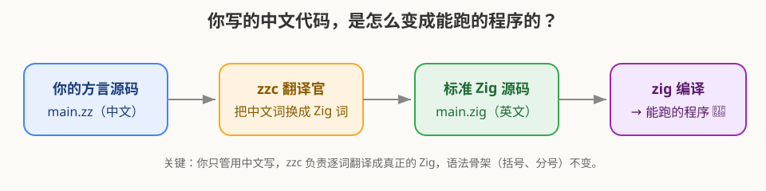
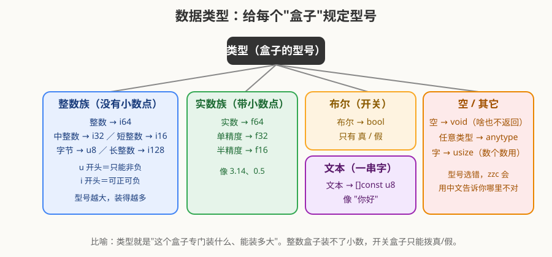
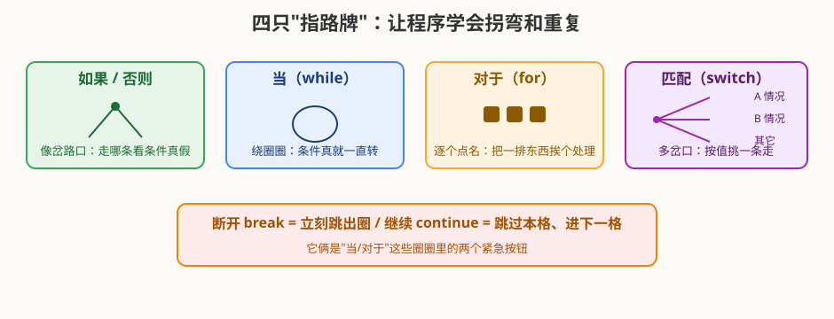
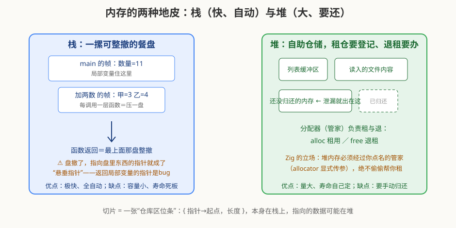
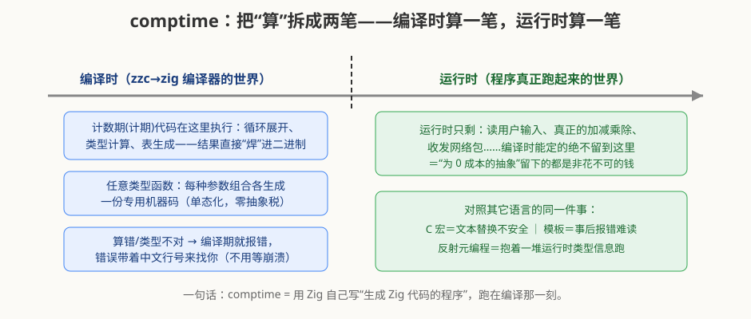
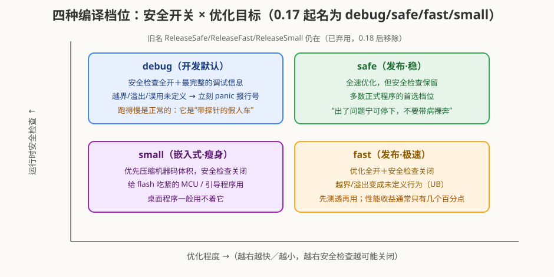
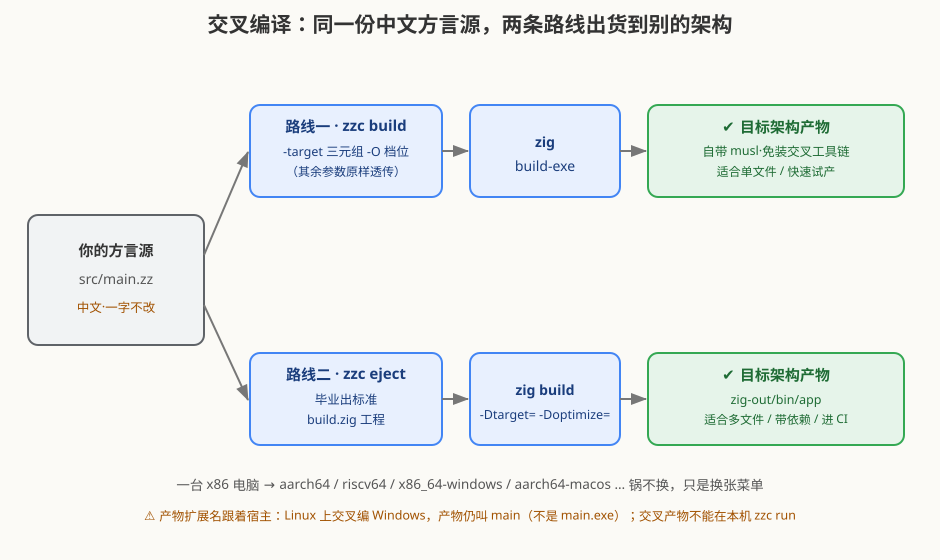

# 母语编写 Zig — 中文版

> 一本**字典级**的零基础编程教程，也是一份**资深 Zig 工程师可查阅参考的机制与工程手册**。
> 零基础读者：全程**大白话 + 生活比喻**，讲到每个中文关键字都给出「它对应标准 Zig 的哪个词、是什么意思、怎么用最小例子」。
> 有经验读者：直接翻**第二篇·深潜篇**（语言机制与编程思想）与**第三篇·软件工程篇**（架构、测试、性能、安全），以及末尾《字典篇》全词表。
> 你不需要英文很好，也不需要数学很好。只要会打字、会做加减乘除，就能学会用中文写程序。

---

## 如何使用这本书

- **零基础，第一遍**：从第 0 章读到第 10 章即完整入门，每章后面有「小练习」；深潜篇读不懂可以先跳过，不是拦路石。
- **想登堂入室 / 已有其它语言经验**：读**第二篇 第 11~17 章**（编程思想、内存本质、分配器、错误与可选的本质、comptime、并发现状、互操作与发布档位），再看**第三篇 第 18~23 章**（工具链与交叉编译、模块设计、测试体系、代码自述、性能、安全）——里面有本仓库 zzc 自身的真实工程案例。
- **只想查词**：直接翻最后的 **《字典篇》**，按主题分组列出每一个中文词的对应写法、比喻和例句，像查字典一样用。
- **卡住了**：看 **附录 A 常见坑**，那里汇总了新手最容易踩的雷。
- 全书技术基线：**Zig 0.17 / zzc 0.1**。Zig 标准库仍在快速演化，深潜篇中涉及 std 具体 API 的形制均以 0.17 实测钉准；换版本时先查官方文档。
- 正文里有三类带图标的旁注，按身份各取所需：🔬 **深潜指针**（基础篇章末，指向机制真相，第一遍可跳过）、⚠️ **易犯错**（新手最常踩的雷：写错时编译器怎么报、怎么改）、🎓 **专家提示**（给有经验读者的底层机制、版本差异与工程取舍，可当速查）。

书里的方言只替换**关键词的拼写**（把 `const` 写成 `常数`），语法的骨架——括号 `()` `{}` `[]`、分号 `;`、等号 `=`、`@`、`?` 等——**保持英文原样**。这一点会贯穿全书。

## 目录

- [序：为什么能用中文写程序？](#序：为什么能用中文写程序？)
- **第一篇 · 基础篇**
  - [第 0 章 把工具装好，端上第一盘菜](#第-0-章-把工具装好，端上第一盘菜)
  - [第 1 章 编程世界的几个基本比喻](#第-1-章-编程世界的几个基本比喻)
  - [第 2 章 语法骨架：哪些还是「英文符号」](#第-2-章-语法骨架：哪些还是「英文符号」)
  - [第 3 章 数字、文字，和它们的运算](#第-3-章-数字、文字，和它们的运算)
  - [第 4 章 让程序学会「看情况办事」（控制流）](#第-4-章-让程序学会「看情况办事」（控制流）)
  - [第 5 章 重复的力量（循环）](#第-5-章-重复的力量（循环）)
  - [第 6 章 函数：把一段活打包起来反复叫](#第-6-章-函数：把一段活打包起来反复叫)
  - [第 7 章 会出错怎么办：错误与可选](#第-7-章-会出错怎么办：错误与可选)
  - [第 8 章 把数据打包：结构 / 枚举 / 联合](#第-8-章-把数据打包：结构--枚举--联合)
  - [第 9 章 标准库地图：那些带点号的长名字](#第-9-章-标准库地图：那些带点号的长名字)
  - [第 10 章 幕后：zzc 到底怎么把你写的中文变成 Zig](#第-10-章-幕后：zzc-到底怎么把你写的中文变成-zig)
- [第二篇 · 深潜篇（进阶）：语言的机制与编程思想](#第二篇-·-深潜篇（进阶）：语言的机制与编程思想)
  - [第 11 章 Zig 的三颗心：显式即尊重](#第-11-章-zig-的三颗心：显式即尊重)
  - [第 12 章 内存的本质：从盒子到地址](#第-12-章-内存的本质：从盒子到地址)
  - [第 13 章 分配器工程：谁付桌费](#第-13-章-分配器工程：谁付桌费)
  - [第 14 章 类型的本质：可选与错误是怎么塞进寄存器的](#第-14-章-类型的本质：可选与错误是怎么塞进寄存器的)
  - [第 15 章 comptime：编译时也是运行时](#第-15-章-comptime：编译时也是运行时)
  - [第 16 章 并发的现状：Zig 为什么「退了」](#第-16-章-并发的现状：zig-为什么「退了」)
  - [第 17 章 互操作与发布档位：怎么和世界共处](#第-17-章-互操作与发布档位：怎么和世界共处)
- [第三篇 · 软件工程篇（进阶）：让代码活得久](#第三篇-·-软件工程篇（进阶）：让代码活得久)
  - [第 18 章 工具链与交叉编译：一台机器给别的架构出货](#第-18-章-工具链与交叉编译：一台机器给别的架构出货)
  - [第 19 章 模块设计与「散在字面量」的教训](#第-19-章-模块设计与「散在字面量」的教训)
  - [第 20 章 质量三层网：测试即工程](#第-20-章-质量三层网：测试即工程)
  - [第 21 章 让代码自述：命名、注释与版本节奏](#第-21-章-让代码自述：命名、注释与版本节奏)
  - [第 22 章 性能工程：先测量，再动手](#第-22-章-性能工程：先测量，再动手)
  - [第 23 章 安全与底线：内存安全的边界与 UB 的对账](#第-23-章-安全与底线：内存安全的边界与-ub-的对账)
- [《字典篇》——像查字典一样查每个中文词](#《字典篇》像查字典一样查每个中文词)
  - [一、声明与函数](#一、声明与函数)
  - [二、控制流](#二、控制流)
  - [三、错误与可选](#三、错误与可选)
  - [四、字面值](#四、字面值)
  - [五、类型别名](#五、类型别名)
  - [六、内置函数（`@` 系，保留 `@` 原名亦可）](#六、内置函数（-系，保留--原名亦可）)
  - [七、标准库路径别名（点分链、贪心最长匹配）](#七、标准库路径别名（点分链、贪心最长匹配）)
  - [八、保留符号（不是关键词、但你需要会读）](#八、保留符号（不是关键词、但你需要会读）)
- [附录](#附录)
  - [附录 A：新手最容易踩的坑](#附录-a：新手最容易踩的坑)
  - [附录 B：术语小词典](#附录-b：术语小词典)
  - [附录 C：进一步学习](#附录-c：进一步学习)
- [结语](#结语)

---

## 序：为什么能用中文写程序？

想象你手里有一台**很厉害但只懂英文的机器**（它叫 **Zig**）。过去你要喂给它的「指令」必须是英文单词，比如 `const`（常数）、`fn`（函数）、`if`（如果）。很多刚入门的朋友就卡在这：道理都懂，可那些英文单词老是记混。

这个项目叫 **zzc**，它像一个**贴身翻译官**：

> 你用中文写 → 翻译官逐词换成标准英文 → 机器照样跑得很好。



所以本质上，你写的仍然是**真正的 Zig 程序**，只是给它戴了一顶中文的「帽子」。学会它，你既懂了中文编程，也顺便搞懂了 Zig——一举两得。

一句大实话：**程序=给电脑写的一份「菜谱」**。你写下每一步操作，电脑老老实实一步一步照着做。下面我们就从「点火做饭」开始。

---

## 第 0 章 把工具装好，端上第一盘菜

### 0.1 三个最常敲的命令

在装有 `zzc` 的终端里，一个工程目录下面只要三招：

| 命令 | 大白话 | 比喻 |
|---|---|---|
| `zzc init 工程名` | 新建一个空工程 | 支起一口新锅 |
| `zzc check` | 只检查有没有写错 | 尝一口咸淡，不上桌 |
| `zzc run` | 检查通过就跑起来 | 正式开火出锅 |

### 0.2 第一个程序，逐行拆给你看

下面这段就是你工程里 `src/main.zz` 可以写的内容。先别怕，我们一行一行讲。

```zz
// zzc 中文方言示例：hello
常数 标准库 = 导入("std");

公开 函数 主函数() !空 {
    变量 数量: 整数 = 10;
    数量 = 数量 + 1;
    标准库.调试.打印("数量是：{d}\n", .{数量});
}
```

逐行翻译成人话：

1. `// ...` 开头是**注释**——写给人看的备忘，电脑直接忽略它（就像菜谱边上你写的「这步别忘」）。
2. `常数 标准库 = 导入("std");`
   - `常数` = 「起个名字，定死不改」；
   - `导入("std")` 就是把标准工具箱 `std`（standard 标准库）拿进来；
   - 整句：把标准工具箱拿来，给它起个中文名「标准库」。
3. `公开 函数 主函数() !空 {`
   - `函数` = 「一段可以反复叫来干活的小程序」；
   - `主函数`（main）= 整个程序**开机后的第一个入口**，程序从它开始跑；
   - `公开`（pub）= 「外面也能叫得动它」；
   - `!空` 先记成「它干活后可能报告出错，也可能啥结果都不返回（空=void）」，第 7 章细讲。
4. `变量 数量: 整数 = 10;`
   - `变量` = 「起个名字，以后还能改」；
   - `数量` 是名字；`: 整数` 说明这盒子装的是**整数**；`= 10` 先放 10 进去。
5. `数量 = 数量 + 1;` 把「数量」里的数拿出来，加 1，再放回去 → 现在它是 11。
6. `标准库.调试.打印("数量是：{d}\n", .{数量});`
   - 调用工具箱里的「打印」功能，把文字加上 `数量` 的值输出到屏幕；
   - `{d}` 是个「占位坑」，会被后面 `.{}里` 的值填上；`\n` 是「换行」。

跑起来你会看到屏幕打印：

```
数量是：11
```

**恭喜，你已经运行了第一个中文程序！** 里面每个词（常数/函数/导入/变量/打印…）都能在《字典篇》查到。

> 小练习：把 `10` 改成 `5`，把 `数量 + 1` 改成 `数量 * 3`，猜打印出来是几，再用 `zzc run` 验证。

> ⚠️ **易犯错**：`主函数` 的拼写、`()` 与 `;` 都要用**英文半角**符号——中文全角括号 `（）`、全角分号 `；` 会被 zzc 当场拦下并告诉你哪一行。报错别慌，它通常直接指出「哪个词、第几行、怎么改」。

---

## 第 1 章 编程世界的几个基本比喻

把抽象概念落地成生活场景，是这本书的核心方法。先记住四个比喻：

### 1.1 程序 = 菜谱
一份菜谱写清楚「先干什么、再干什么」。程序也是：一行一行、从上到下被执行。顺序很重要——你不会在「打蛋」之前先「把蛋糕进烤箱」。

### 1.2 内存 = 一排盒子
电脑的记忆就像一排可以贴标签的盒子。你往盒子里放东西（存数据），以后可以叫名字拿出来用（读数据）。

### 1.3 变量 / 常数 = 两种盒子


- **常数（const）**：东西放进去后**贴上封条**，再也不许换。
  `常数 圆周率 = 3.14;` —— 写完就不能再 `圆周率 = 3;`，否则 zzc 会拦你。
- **变量（var）**：盖子开着，随时能换新东西。
  `变量 年龄 = 18;` 以后可以 `年龄 = 19;`。

> 好习惯：**能用常数就别用变量**。因为「定死不改」的东西更安全，也更容易让人读懂。

### 1.4 类型 = 盒子的型号


不是所有盒子都能装所有东西。装整数的小盒子塞不进小数。「类型」就是规定：**这盒子专门装什么、能装多大**。上一章的 `整数`、后面会遇到的 `实数`（带小数）、`布尔`（真/假开关）、`文本`（一串字）就是不同的型号。

> ⚠️ **易犯错**：`常数` 一旦绑定就不能再改，写 `数量 = 数量 + 1;` 会报 `不可变常量被重新赋值`（cannot assign to constant）。要变的用 `变量`；反过来 `变量` 声明后从不改，编译器会劝你改用 `常数`（只读更安全、更易读）。

> 🔬 **深潜指针**：「盒子」是入门善意的比喻。内存的真实样子（栈、堆、指针、`undefined` 毒值）在深潜篇第 12 章；类型在寄存器里到底占几个字节，在第 14 章。

---

## 第 2 章 语法骨架：哪些还是「英文符号」

方言只把**关键词**换成了中文，但**结构性符号保持不变**。别慌，它们很少也很好记：

| 符号 | 叫什么 | 用来干嘛 | 比喻 |
|---|---|---|---|
| `( )` | 圆括号 | 包住函数的参数、表达式分组 | 菜名后面的「（配料）」 |
| `{ }` | 花括号 | 把「一坨步骤」框在一起 | 一个锅盖住的范围内 |
| `[ ]` | 方括号 | 数组/切片、取第几个 | 一排抽屉的编号 |
| `;` | 分号 | 一句话说完，打句点 | 中文里的句号 |
| `=` | 等号 | 声明时「放值进去」、语句里「换成新值」 | 往盒子里搁东西 |
| `:` | 冒号 | 「这个盒子是什么型号」 | 标签上写「专装整数」 |
| `@` | 井号类前缀 | 内置操作，如 `导入`=`@import` | 工具箱上的闪电按钮 |
| `!` | 惊叹号 | 「这个动作可能出错」 | 提示「小心！可能会失败」 |
| `?` | 问号 | 「可能有值，也可能没有」 | 盒子可能空着 |

一句话：**中文负责「做什么」，英文符号负责「怎么框起来」**。你写的时候，中文词照读，符号照英文习惯敲。

> ⚠️ **易犯错**：新手最频繁的翻车点是**中文全角标点**——`（）` `｛｝` `；` `：` 看着像、其实是另一个码点，zzc 会拒绝并报。请始终用英文半角 `() {} ; :` 框骨架，只有**关键词和中文标识符**用中文。

---

## 第 3 章 数字、文字，和它们的运算

### 3.1 字面量：直接写出来的值

| 中文 | 标准 Zig | 说明 | 例子 |
|---|---|---|---|
| 真 | `true` | 布尔的「对」 | `常数 灯亮 = 真;` |
| 假 | `false` | 布尔的「错」 | `常数 灯亮 = 假;` |
| 空值 | `null` | 「这里啥也没有」 | 第 7 章细讲 |
| 未定义 | `undefined` | 「先占个名，值待定」 | `变量 x: 整数 = 未定义;` |

数字和文字直接写就行：整数 `42`、小数 `3.14`、文本 `"你好，世界"`。

### 3.2 常用类型速查（详见《字典篇》）

| 中文类型 | = 标准 | 装什么 |
|---|---|---|
| 整数 | `i64` | 可正可负的整数 |
| 中整数 | `i32` | 稍小的整数 |
| 字节 | `u8` | 0～255 的整数（也常当一块内存） |
| 无符号整数 | `u64` | 只能非负的大整数 |
| 实数 | `f64` | 带小数点 |
| 布尔 | `bool` | 真 / 假 |
| 文本 | `[]const u8` | 一串字（只读） |
| 字符串 | `[]u8` | 一串字（可改） |
| 空 | `void` | 「不返回任何东西」 |
| 任意类型 | `anytype` | 「什么型号都行」（写通用函数用） |

> 比喻：`u` 开头的盒子「只能装非负数」（unsigned 无符号），`i` 开头的「可正可负」（integer）。型号数字越大，能装的数越多、占的地方也越大。

### 3.3 算术与比较

四则运算里 `+  -  *` 直接用符号，取余用 `%`（除不尽剩下的）；**整数除法例外**（见下方易犯错）。比较大小返回「真/假」：`==  !=  <  <=  >  >=`。

```zz
常数 和 = 3 + 4;         // 7
常数 余 = 10 % 3;        // 1
常数 商 = 截断除法(10, 3); // 3（有符号整数除法要显式函数，见下）
常数 相等吗 = (和 == 7); // 真
```

> ⚠️ **易犯错**：`整数`（`i64`，有符号）**不能直接用 `/` 相除**，Zig 要你写明「除不尽时怎么圆整」：向零截断用 `截断除法`（`@divTrunc`）、向下取整用 `向下除法`（`@divFloor`）、要求整除用 `精确整除`（`@divExact`）。`实数`（`f64`）则可以直接 `/`。忘了写会报 `signed integers must use @divTrunc …`。

### 3.4 内置函数（`@` 系）：工具箱里的闪电按钮

有一批「标准库都不用拿、随时能按」的内置操作。方言给它们都配了中文名（也可以照写英文 `@` 原名）：

| 中文 | 标准 | 作用 |
|---|---|---|
| 导入 | `@import` | 引入一个模块（几乎每个文件第一句都用它） |
| 最大 / 最小 | `@max` / `@min` | 取两者较大/较小 |
| 绝对值 | `@abs` | 去掉负号 |
| 平方根 | `@sqrt` | 开平方 |
| 下取整 / 上取整 | `@floor` / `@ceil` | 往下/往上取整 |
| 四舍五入 | `@round` | 就近取整 |
| 类型大小 | `@sizeOf` | 某类型占几字节 |
| 取类型 | `@TypeOf` | 问「这是啥类型」 |

（完整 `@` 词表在《字典篇 · 内置函数》。）

```zz
常数 a = 最大(3, 9);       // 9
常数 b = 绝对值(-5);       // 5
常数 c = 平方根(16.0);     // 4.0
```

> 小练习：用 `下取整` 和 `上取整` 分别算 `3.7`，看看结果各是多少？

> ⚠️ **易犯错**：两个 `整数` 相加超出范围（溢出）时，debug/safe 档会**当场停并报行号**，而不是悄悄绕回负数——带着错的值继续算下去更糟。确实要「模回去」请显式写 `+%`（环绕加）；整数与实数之间不会自动转换，需手动 `@floatFromInt` 等。

> 🎓 **专家提示**：方言的 `整数` 对应标准 Zig 的 `i64`、`实数` 对应 `f64`；`isize`/`usize` 是与指针同宽的带/无符号整型（写循环索引、长度常用）。数字字面量会按上下文自动适配类型，拿不准时 `常数 x: 整数 = 5;` 显式标型号。类型在寄存器里的真实宽度用 `@sizeOf` 一行测出。

> 🔬 **深潜指针**：`整数` 到底是几位、溢出会发生什么、为什么数字之间只允许「无损加宽」——深潜篇第 12 章（布局）与第 11 章（没有魔法隐式转换）给出答案。

---

## 第 4 章 让程序学会「看情况办事」（控制流）

程序最强大的地方就是**能拐弯、能重复**。先记住这张地图：



### 4.1 如果 / 否则（if / else）：岔路口

```zz
如果 (年龄 >= 18) {
    标准库.调试.打印("成年了\n", .{});
} 否则 {
    标准库.调试.打印("未成年\n", .{});
}
```

- `如果 (条件) { ... }` ：条件为**真**才走花括号里的路。
- `否则 { ... }` ：条件为**假**时走这条路（可选，不写就没有备选）。
- 多个条件可以串起来：`如果(...) { } 否则如果(...) { } 否则 { }`。

比喻：出门前**如果**下雨就带伞，**否则**戴帽子。

### 4.2 匹配（switch）：多岔口，按值挑一条

当「情况」不止两种，与其写一长串 `否则如果`，不如用 `匹配`：

```zz
匹配 (星期) {
    1 => 标准库.调试.打印("周一\n", .{}),
    2, 3 => 标准库.调试.打印("周中\n", .{}),
    6, 7 => 标准库.调试.打印("周末\n", .{}),
    否则 => 标准库.调试.打印("其它\n", .{}),
}
```

- `=>` 左边是「命中哪种值」，右边是「那就做啥」。
- `否则`（对应标准 Zig 的 `else`）是「以上都不是」的兜底（Zig 要求你把它写全，防止漏掉情况）。

> ⚠️ **易犯错**：`匹配` 必须穷尽所有可能，漏一支就编译报错（switch must handle）。拿不准就在最后加一条 `否则 => ...` 兜底；对枚举做 `匹配` 时，日后新增枚举成员会让原本「看似完整」的匹配当场变红——这正是它比 `if-else` 链安全的地方。

> 🎓 **专家提示**：`匹配`（switch）在 Zig 里是**表达式**不是语句——每个分支都交出一个值，可以 `常数 x = 匹配(星期) { ... };` 直接拿返回值。多值共享一支写 `2, 3 =>`；把命中的值绑定出来用 `否则 => |v| ...`（标准形即 `else => |v|`，0.17 实测）。

---

## 第 5 章 重复的力量（循环）

### 5.1 当（while）：条件为真就一直转

```zz
变量 i: 整数 = 0;
当 (i < 3) {
    标准库.调试.打印("i = {d}\n", .{i});
    i = i + 1;   // 千万别忘了推进，否则永远转不停
}
```

`当 (条件) { ... }`：每轮先看条件，真就执行花括号，再回来看条件……假了才停。

### 5.2 对于（for）：把一排东西挨个点名

```zz
常数 分数 = [_]整数{ 90, 85, 70 };
对于 (分数) |一份| {
    标准库.调试.打印("这份是 {d}\n", .{一份});
}
```

`对于 (一批数据) |单个名字| { ... }`：自动把这批数据一个一个拿出来，`|一份|` 就是「当前拿到的这个」的临时名字。

### 5.3 断开 / 继续：圈里的两个紧急按钮

- `断开`（break）：**立刻跳出整个圈**，不再转了。
- `继续`（continue）：**跳过这一轮剩下的**，直接进入下一轮。

```zz
变量 n: 整数 = 0;
当 (真) {
    n = n + 1;
    如果 (n == 3) 继续;   // 3 这轮不打印，直接进下一轮
    如果 (n > 5) 断开;     // 超过 5，整个圈停了
    标准库.调试.打印("{d} ", .{n});
}
// 打印效果：1 2 4 5
```

> ⚠️ **易犯错**：`断开`（break）、`继续`（continue）只能写在循环体内，放到循环外会报 `... outside loop`；`当`（while）循环把计数器推进漏掉就是死循环。

> 🎓 **专家提示**（0.17 实测）：`当 (条件) : (推进表达式) { ... }` 的**续行式**会在每轮结尾（连 `继续` 跳过的那轮也跑）执行，比把 `i = i + 1` 塞进体内更安全。另：**0.17 移除了 `对于 (切片) |项, 下标|` 的隐式下标捕获**（旧教程高频写法，现报 `extra capture in for loop`）——要下标请改 `对于 (0..切片.len) |下标| ...` 或自维计数器。（而 `对于 (甲, 乙) |x, y|` 那种**同时遍历两条切片**的双捕获仍合法。）

---

## 第 6 章 函数：把一段活打包起来反复叫

### 6.1 基本形

```zz
函数 加两数(甲: 整数, 乙: 整数) 整数 {
    返回 甲 + 乙;
}
```

- `函数 名字(参数: 类型, ...)` 定义一个「干活的小程序」。
- 括号后面 `整数` 是**返回类型**（这活干完交出什么型号的成品）。
- `返回`（return）交出结果并结束函数。

调用：`常数 结果 = 加两数(3, 4); // 7`

### 6.2 主函数（main）：程序的总入口

每个可执行程序都要有一个 `主函数`（标准 Zig 里的 `main`）。程序一开机，第一个被叫去干活的就是它。为什么写 `!空`？

- `空`（void）：它**不交出成品**（只是「做事」，不「交东西」）。
- `!`：它**可能会报告出错**。合起来 `!空` = 「可能出错、正常啥也不返回」。第 7 章细讲。

### 6.3 公开（pub）：让别人也叫得动

加了 `公开` 的函数，**别的文件也能调用**；不加就只在本网页（本文件）内部可用。比喻：贴了「对外开放」招牌的窗口 vs 内部员工专用窗口。

### 6.4 任意类型（anytype）：什么型号都能接的通用函数

```zz
函数 打印它(内容: 任意类型) 空 {
    标准库.调试.打印("{any}\n", .{内容});
}
```

`任意类型`（anytype）= 「参数什么类型都行」，用来写通用工具。（这是 Zig 很有特色的一招，入门先知道有它即可。）

> 小练习：写一个 `函数 平方(数: 整数) 整数`，让它返回 `数 * 数`，然后在 `主函数` 里打印 `平方(6)`。

> ⚠️ **易犯错**：返回类型带 `!` 的函数，调用处必须 `尝试`（往上抛）或 `捕获`（就地兜底）二选一，直接裸调会报 `expression must be handled`；函数签名也不能只写名字不写返回型号（`) 整数`）。

> 🔬 **深潜指针**：`任意类型`（anytype）参数为什么没有运行时开销——每种类型组合各自生成一份专用机器码（单态化）。机制详见深潜篇第 15 章 comptime。

---

## 第 7 章 会出错怎么办：错误与可选

真实世界的操作常会失败：文件打不开、除数是 0、网络断了。Zig 把「可能失败」**明写在类型里**，方言照样用中文表达。

### 7.1 尝试（try）：允许失败的动作

主函数签名里的 `!空`，那个 `!` 就是「这里面可能有错」。当你要做一件**可能失败**的事，前面加 `尝试`（try）：

```zz
公开 函数 主函数() !空 {
    尝试 可能失败的活();
}

函数 可能失败的活() !空 {   // 会失败、但不返回有用值
    返回;
}
```

`尝试 做某事()` 读作：「去干这事；**万一它报错**，就立刻把错误往上一层抛出去」。就像走钢丝下面的**安全网**——掉下去不会摔死，而是被网兜住、传到更外层处理。

### 7.2 错误（error）与 任错（anyerror）

```zz
常数 我的错 = 错误{ 没找到, 数量为负 };
```

- `错误{ ... }` 定义一组成员可命名的错误（`没找到`、`数量为负`）。
- `任错`（anyerror）是「任意一种错误」的统称。
- 函数返回类型 `!整数` 读作：「要么给一个整数，要么报错」。

### 7.3 捕获（catch）与 或不然（orelse）：就地兜底

不想让错误往上抛，就在原地「接住」给个备胎：

```zz
常数 值 = 冒险活() 捕获 0;      // 出错就用 0 顶上
常数 名称 = 找名字() 或不然 "无名"; // 没找到就用默认名
```

- `捕获 备用值`（catch）：前面失败就用后面顶上。
- `或不然 备用`（orelse）：专给「可能是空」的东西配一个默认。

### 7.4 可选值：问号 `?` 与 空值（null）

`?整数` 读作「要么是个整数，要么是 `空值`（null，什么都没有）」。

```zz
变量 年龄: ?整数 = 空值;   // 先空着
年龄 = 20;                 // 之后可以是 20
常数 岁数 = 年龄 或不然 0;  // 空的话按 0 算
```

### 7.5 延迟（defer）与 错延（errdefer）：记得收尾

比喻：进门开了灯，**出门要记得关**。`延迟` = 「等这一段结束时，务必做这件收尾事」（常用来关文件、还内存）。

```zz
变量 文件 = 尝试 打开(路径);
延迟 文件.关闭();   // 不管从哪个出口离开这段，最后都会执行关闭
```

`错延`（errdefer）只在**出错离开**时才做收尾（成功则不做），用于「失败了要把资源还原」。`待处理`（unreachable）是「这条分支绝不可能走到，走到了就是 bug」。

> ⚠️ **易犯错**：`?T` 的可空值不能直接当值用——`.?` 解引用前先判空，或用 `或不然`（orelse）给默认；`!T` 的结果也不许被丢弃（`error union is discarded`），必须 `尝试`/`捕获`/`如果` 三选一处理。也别用 `尝试` 去「断言内部逻辑一定对」，那是 `断言`/`待处理` 的活。

> 🎓 **专家提示**：错误集成员本质是一个**小整数**，`!T` 多数形态只比 `T` 多一个机器字（详见第 14 章）——这就是「错误处理零额外开销」的物理根据；`任错`（anyerror）会退化成「我也不知道会错哪」，具名错误集永远优于它。

> 🔬 **深潜指针**：`?整数` 和 `!整数` 在机器里到底长什么样、为什么 `!T` 恰好只多花一个机器字、错误值为什么是一个「小整数」——深潜篇第 14 章逐位拆解。

---

## 第 8 章 把数据打包：结构 / 枚举 / 联合

单个盒子不够用时，要把「一组相关的数据」打包成一个新形状。

### 8.1 结构（struct）：自定义一张表格

```zz
常数 人 = 结构 {
    姓名: 文本,
    年龄: 整数,
};

常数 张三 = 人{ .姓名 = "张三", .年龄 = 20 };
```

`结构`（struct）= 「给一组字段套一个总名字」，像给一张表格起名。之后 `张三.年龄` 就能取出某一格。（Zig 里 `结构` 是最常用的复合类型，连文件顶部的很多定义都是它。）

### 8.2 枚举（enum）：只能是几个固定选项之一

```zz
常数 状态 = 枚举 { 进行中, 成功, 失败 };
变量 现在: 状态 = .成功;
```

`枚举`（enum）= 「把合法的几种取值列成一个清单」。`现在` 只能是这三者之一，写别的会报错。适合表示「订单状态」「开关档位」等有限选项。

### 8.3 联合（union）：一次只装一种，但带标签

```zz
常数 值 = 联合(枚举) {
    整数: 整数,
    实数: 实数,
    文本: 文本,
};
```

`联合`（union）= 「这个盒子这一时刻**只装一种**东西，但事先声明可能是哪几种」。搭配第 4 章的 `匹配` 使用最顺手——按当前装的是哪种，分别处理。（进阶，入门先混个眼熟。）

> ⚠️ **易犯错**：带标签的联合正确写法是 `联合(枚举) { ... }`（不是 `联合(标签: 枚举)`——那是网上旧教程的伪形，0.17 直接语法错）。取某一支前先用 `匹配` 判标签；只有编译期能确定当前标签时，`值.整数` 这种直接取字段才合法。

---

## 第 9 章 标准库地图：那些带点号的长名字

标准 Zig 有个巨大的官方工具箱 `std`（standard）。方言把它翻译成了中文，用**点号 `.` 像门牌号一样一级级连下去**。

### 9.1 点分链：从大到小一路点名

以你见过的 `标准库.调试.打印` 为例：

```
标准库  .  调试  .  打印
 std        debug     print
```

- `标准库` = `std`（整个工具箱）
- `.调试` = `.debug`（工具箱里「调试」这个抽屉）
- `.打印` = `.print`（抽屉里的「打印」工具）

> 规则：**每一级都可以是中文，也可以中英混着写**。没专门翻译的成员会自动退回英文原名，所以 `标准库.mem.eql` 这种「半中半英」也照样能用。注意：要当中文链用，**每一段得是纯中文词**，夹了英文字母的段会被当普通标识符、匹配不上别名。

### 9.2 常用成员速查

| 中文长名 | 标准 Zig | 干嘛用 |
|---|---|---|
| 标准库.调试.打印 | `std.debug.print` | 往屏幕输出（最常用） |
| 标准库.调试.断言 | `std.debug.assert` | 「这里必须为真，否则崩给我看」 |
| 标准库.内存.分配器 | `std.mem.Allocator` | 内存管家（要动态内存时找它） |
| 标准库.列表 | `std.ArrayList` | 会变长的数组（动态列表） |
| 标准库.字符串哈希表 | `std.StringHashMap` | 字符串→值 的字典 |
| 标准库.格式化.分配打印 | `std.fmt.allocPrint` | 拼一个新字符串（需分配内存） |
| 标准库.数学.平方根 | `std.math.sqrt` | 数学函数族（与内置 `平方根` 同术语） |
| 标准库.测试.相等 | `std.testing.expectEqual` | 写测试用的断言 |

（更多见 `docs/关键字对照表.md`，那是最全的词表来源。）

> ⚠️ **易犯错**：`标准库.列表`（ArrayList）在 0.17 是「先 `.empty` 建空、每次增删都点名传分配器」的新形制：`变量 名单: 标准库.列表(整数) = .empty;` 然后 `尝试 名单.append(分配器, 值);`——老版本 `init(分配器)` 把管家绑死在列表里的写法已退役，照旧教程抄会报错。

> 🎓 **专家提示**：`deinit` 只在你要**提前**归还堆内存时才需要；程序退出时 OS 会回收，但测试里用 `std.testing.allocator` 会验「一字节不留」，漏 `deinit` 当场红（见 13.6）。

> 🔬 **深潜指针**：`标准库.内存.分配器` 为什么要「点名传来传去」、`标准库.列表` 在 0.17 的新形制（`.empty` + 逐次传分配器）与旧写法的差别——深潜篇第 13 章整章讲这件事。

---

## 第 10 章 幕后：zzc 到底怎么把你写的中文变成 Zig

理解了原理，你就不会怕「我写的还是不是真 Zig」这个问题。

### 10.1 两级翻译

1. **关键词/别名替换**：`常数→const`、`函数→fn`、`导入→@import`、`标准库→std`……这些查表完成，见《字典篇》。
2. **标识符转码**：你没在词表里的**中文名字**（比如 `数量`、`张三`、`加两数`），会被换成稳定英文代号 `z_1`、`z_2`……并保证**同一个工程里，同一个中文名字永远换成同一个代号**。

所以第 0 章那句 `变量 数量: 整数 = 10;` 被翻译成标准 Zig 后大致是：

```zig
var z_1: i64 = 10;
```

### 10.2 符号表 .zzc/symbols.txt

「中文名字 ↔ 英文代号」的对照，存在工程的 `.zzc/symbols.txt` 里，跨文件、跨次运行都一致。你不用手改它，它由 zzc 自动维护。

### 10.3 eject 毕业：交出一份纯 Zig 工程

学到一定程度，你可能想把项目**「毕业」成没有中文、纯标准 Zig 的工程**，交给只认英文的同事或环境。命令：

```
zzc eject
```

它导出一份标准 Zig 工程（`standard/`），并把你的中文原名以注释形式保留在导出文件头部——即「能读回你当初起的名字」，但编译运行完全是原生 Zig，**不再需要 zzc**。这印证了序章那句话：你写的从来就是真 Zig，中文只是它一开始戴的帽子。

> ⚠️ **易犯错**：别拿方言关键词当自己的变量/函数名（如 `常数 导入 = 1;`）——关键词查表只在**声明位**避让，调用处会被换成 `@import`，拼出碎代码。起中文名时避开 `常数/函数/如果/导入` 这些保留词。

> 🎓 **专家提示**（本仓库实测）：`.zzc/symbols.txt` 是跨次运行稳定的中文↔代号转码缓存；若某次用坏形把关键字误固化进去，同一工程里会「怎么改都报错」，`rm -rf .zzc` 全新目录即复原——排查 zzc 报错时先用干净工程复现，别被缓存污染误导。

> 🔬 **深潜指针**：`symbols.txt` 的映射与 Zig 侧的命名/`extern` 规则如何配合、「毕业」之后在 C 边界怎样继续用原名——深潜篇第 17 章；这类「一张对照表养活整个工程」的维护纪律，见软件工程篇第 19 章。

---

# 第二篇 · 深潜篇（进阶）：语言的机制与编程思想

> 这一篇写给两种人：读完第一遍想问「为什么」的新手，和想找一份机制备忘的资深 Zig 工程师。每章套路统一：先用比喻带路，再讲机制本尊，最后给一张「工程判据」卡。新手允许自己只懂七成——等你多写几年代码再回来重读，会突然全通；专家可直接跳读任意一节，所有 API 形制均按 Zig 0.17 实测钉准。

## 第 11 章 Zig 的三颗心：显式即尊重

### 11.1 语言到底是给谁用的

一门编程语言的真正用户有三个：**你、三年后接手的人、机器**。机器不介意你写得乱，但「三年后的人」没法从坟里爬出来问你脑子里的隐藏前提。所以好语言的核心美德只有一个——**把重要的事全部写在明面上**。Zig 为此立了三条铁律。

### 11.2 三条铁律

**铁律一：没有隐藏控制流（No Hidden Control Flow）。**

比喻：后厨菜谱不许「隐形加戏」——写着「加盐」却偷偷帮你颠勺，你就没法做菜了。

- 别的语言的暗流：Java/Python 的任何一行都可能抛异常飞出去，函数签名却不告诉你；C++ 运算符重载能让 `a + b` 悄悄写数据库。
- Zig 的立场：`[]` 就是索引，不许重载；「可能失败」必须写成签名里的 `!`，调用方必须当面用 `尝试`（往上抛）或 `捕获`（就地兜底）处理。看屏幕就能知道下一步会执行哪一行——想不出「下一步去哪」的时候，答案一定在纸上。

**铁律二：没有隐藏分配（No Hidden Allocation）。**

比喻：吃别人席不能偷偷记账到你卡上。

- 别的语言里，建个变量、拼个字符串，后台就悄悄堆分配了，GC 事后打扫战场（顺便制造停顿）。
- Zig：想碰堆，必须经你**点名一个分配器（allocator）**当参数传进去。一个函数签名里没有分配器参数，就等于它**自证**从不堆分配。编译器想要内存？也得管你借——没有特权。
- 收益一：内存用量可审计、可控制、可封顶（嵌入式和基础设施场景的命根）。
- 收益二：能换上一个「故意失败的假分配器」做测试——内存不够的分支第一次变成可测路径（见 13.6）。
- 收益三：谁分配谁负责，泄漏追责有明确主体（见 13.5）。

**铁律三：没有魔法隐式转换。**

- 整数不会自动变浮点，要换就亲手写 `@as` / `@floatFromInt`——换汇必须看见汇率。「精度损失」这种事不许发生在幕后。
- 数字之间只允许「无损加宽」（小箱子滑进大箱子），反过来一律显式。

### 11.3 一个三条铁律同框的例子

下面这段可直接 `zzc run`（已实测）：

```zz
常数 标准库 = 导入("std");

常数 错误集 = 错误{ 除零 };

公开 函数 安全除(甲: 整数, 乙: 整数) !整数 {
    如果 (乙 == 0) 返回 错误.除零;
    返回 截断除法(甲, 乙);   // 整数是有符号的，除法必须显式（见第 3 章）
}

公开 函数 主函数() !空 {
    常数 商 = 尝试 安全除(10, 2);
    标准库.调试.打印("{d}\n", .{商});
}
```

逐行看「明面账」：`!整数`＝「我会错」写在脸上；`如果 (乙 == 0) 返回 错误.除零`＝出错路径是可以数出来的几条，不是一个黑洞；`主函数` 的 `!空`＝错允许继续往外抛，抛到程序入口由操作系统兜底；全程没有分配器＝**本程序零堆内存**，这是签名层面无可辩驳的事实。

### 11.4 Zig 故意不要的东西（负面清单即设计文档）

| Zig 不要 | 谁在用 | Zig 的替代 | 为什么不要 |
|---|---|---|---|
| 类与继承 | Java/C++ | 结构体 + 函数 + 组合 | 继承把「代码复用」和「is-a 关系」绑死，深层级变遗产 |
| 运算符重载 | C++ | 显式命名的函数 | 读者看表达式猜不出语义，重载滥用变方言 |
| 异常机制 | Java/Python | `!T` + 尝试/捕获 | 控制流必须看得见的同一件事 |
| 垃圾回收 GC | Java/Go | 显式分配器 | 停顿、归属模糊、嵌入式做不了——代价不可控 |
| 预处理器宏 | C | 计期（comptime） | 文本替换无类型检查，错误在爆炸半径之外 |
| 智能指针族 | C++ shared_ptr | 自己写引用计数 / arena | 隐藏语义、循环引用、体积开销 |
| 隐式数值转换 | C | `@intCast` 等显式转换 | 精度损失必须现场签字 |

专家注：这张表的读法不是「Zig 少了什么功能」，而是「Zig 把每个功能还原成了**库的写法**」——引用计数可以写成结构体，模式匹配可以写成 `匹配`，元编程就是 `计期`。语言本体保持小，生态位保持干净。

### 11.5 工程判据卡

- **读代码**：先读函数签名的四个信号——有没有 `!`（会错）、`?`（可空）、分配器参数（碰堆）、`[]常数` vs `[]`（读/写）。签名即设计文档。
- **选型对照**：要「编译器帮我证明程序对」→ Rust 借用检查；要「语言把责任写明白、我自己负责」→ Zig。二者不冲突，是「监护人」与「合同」两种文化。
- **给新手的一句话**：别的语言里暗中发生的事，Zig 全部逼到台面上。遇到「为什么要这么麻烦」，答案九成是「为了让三年后的人不用猜」。

## 第 12 章 内存的本质：从盒子到地址

### 12.1 内存是一长排储物柜

电脑的内存就是一条超长的柜子走廊，每个柜门装 **1 字节**，柜子的编号就是**地址**。「指针」就是写着地址的小纸条：`常数 钥匙 = &甲;`（钥匙的类型就是 `*常数 整数`）表示「纸条上记着甲住几号柜」。取值时捏着纸条走到柜子前开门——这叫**解引用**（`钥匙.*`）。

基础篇说「变量是盒子」，那是善意的谎言；本章起，升级成真话：**变量是某个格子的柜子，名字是你贴的标签，指针是记编号的纸条。**

### 12.2 栈与堆：两种地皮



- **栈**：函数每调用一次，就在这排柜子上**摞一只新餐盘**（叫「帧」），本函数的局部变量全在盘里；函数返回＝最上面那盘整撤，盘里的东西就地消失。快，但寿命焊死在函数进出上。
- **堆**：一整片自助仓储，**租要登记（alloc）、退要办手续（free）**，不退就一直算你租着——这就是泄漏。慢一点，但寿命由你定。

关键字其实是同一个：**寿命**。九成新手 bug 和一半资深工程师的 bug，根源都是「拿着还在的纸条去找已经撤走的餐盘」（悬垂）或「租着忘了退」（泄漏）。

### 12.3 指针与切片家族相册

| 标准形 | 方言读法 | 里面装什么 | 什么时候用 |
|---|---|---|---|
| `*常数 T` | 指向某型号的只读指针 | 1 张纸条 | 函数只想借看一个值，不搬也不改 |
| `[]常数 T` | 只读切片（文本=`[]常数 字节`） | {纸条, 个数} 两词 | **默认首选**：带长度的只读数据视图 |
| `[]T` | 可写切片 | {纸条, 个数} | 要就地修改数据时 |
| `[:0]常数 T` | 哨兵结尾切片 | 纸条+隐含「到0为止」 | 和 C 字符串接口握手 |
| `[*]T` | 多元素裸指针 | 只有纸条，没个数 | 只出现在 FFI 边界，往里就包成切片 |
| `[N]T` | 定长数组（N 写进类型） | 一整排 N 个柜子 | 长度编译期已知；`&数组` 自动变切片 |

两个值得记住的细节：

1. **`数组.len` 在切片上是运行时的真实字段**（就是那个「个数」），在 `[N]T` 上是编译期常量——`*常数 [N]T` 这种形能把长度信息一直锁在类型里，零运行时开销，跨函数传数组又不丢长度的正解。
2. `数组[i]` 的越界检查不是每档都有：debug/safe 会当场 panic 报行号，fast/small 里是未定义行为（见 23.1）。

### 12.4 值拷贝的成本账

Zig 的赋值和传参**默认全量拷贝**——`甲 = 乙;` 就是把乙那排格子原样拓一份。小盒子（整数、布尔）拓一下是一个指令，无所谓；大结构体（几千字节）就是 memcpy 灾难。所以大对象的通行做法是**传 `&`（纸条）而非传值**。好消息：`返回` 一个值时，编译器会直接把成品码到调用方指定的柜位里（返回值优化），你不必为返回大结构体而焦虑；坏消息：它不是保证，性能敏感路径以测量为准（22.1）。

### 12.5 `未定义`（undefined）：埋地雷的规矩

`未定义` 既不是 0 也不是垃圾，是一个「**故意留坑**」的标记：调试档下 Zig 会把它涂成 0xAA 花纹的毒值，谁提前使用谁当场翻车并报行号——错误在**离案发现场最近的地方**引爆，而不是三个月后在某个诡异的计算结果里诈尸。读不出花纹的（fast 档）才是真正的隐患，这就是「用 debug 档跑测试」的又一个理由。

### 12.6 经典致命伤两案（看懂即防雷）

**案一：悬垂指针。**

```zig
fn buggy() *const i32 {
    var local = 42;
    return &local; // 餐盘马上整撤，纸条指向即将消失的柜格
}
```

函数返回时局部变量所在的帧被撤，纸条成废票。正确思路：要么返回值（拷贝不贵），要么把缓冲区由调用方提供（谁拥有谁负责，13.5）。debug 档的毒填充会帮你尽快撞上它，而不是让它潜伏。

**案二：切片失效。**

```zig
var list: std.ArrayList(i32) = .empty;
var oldView = list.items;              // 纸条记着「起点+个数」
list.append(std.heap.page_allocator, 99) catch unreachable; // 扩容＝整体搬家
// oldView 还指着老仓库——已经作废了
```

动态列表扩容时会把数据搬到新柜区，**旧切片不会自动更新**。铁律：**任何可能增删的操作之后，旧切片作废，要视图就从源对象重新取**；或者干脆只存下标，不存指针/切片。

> 实测注：案一这种「直接返回局部地址」，0.17 编译器在 debug 档就能静态拦住（`error: returning address of expired local variable`）。但别松口气——那只是静态可判的特例，更复杂的悬垂（经结构体转手、跨帧缓存）仍然只有靠档位的运行时检查才撞得出来。

### 12.7 工程判据卡

- 动笔前自问三句：**这块内存谁拥有？活多久？谁负责归还？** 答不出就先别写。
- 接口里 `[]常数 T` 就是「只读借条」，`[]T` 就是「可改借条」——让签名自己说话。
- 拿不准谁在用哪个柜格时，别猜：debug 档跑一遍，让毒值和越界检查替你找出来。

## 第 13 章 分配器工程：谁付桌费

### 13.1 为什么要把分配器点名传来（铁律二的落地）

比喻：AA 制饭局。老式语言是「大锅记账」——人人都在吃，账都记在「系统」头上（GC），月底统一清算（停顿）。Zig 是 AA 制：**组织者（owner）揣钱包**，每个人自己报消费量；函数不拿到钱包，就吃不了堆上的东西。

这套看似麻烦的设计买到三样东西：**可测性**（换一个假钱包即可测内存不足分支）、**可观察性**（钱包上装计数器，分配全景透明）、**可决策性**（把程序交给嵌入式的人时，他替你选小钱包，不用求你改代码）。

### 13.2 Allocator 的内部机械：一个指针 + 一张函数表

0.17 实测形制：分配器就是个结构体，只有两个字段——

```
ptr:    *anyopaque          // 管家自己的随身东西（页句柄/缓存池……）
vtable: *const VTable       // 四联职能表：alloc / realloc / resize / free
```

所谓「接口/多态」，在这里就是**手写的函数指针表**：没有隐藏的 vptr 塞进每个对象，没有运行时类型信息包袱——「动态的分派、静态的成本」。所有标准库和第三方容器要分配器时都收同一个 `std.mem.Allocator`，互相就能无缝拼接。

另外钉一个事实：分配类 API 唯一的失败模式是 `error.OutOfMemory`（0.17 的 `Allocator.Error` 实测就这一个成员）——所以「分配失败怎么处理」这个难题被压缩成了「你愿意为 OOM 做什么」这一个决策。

### 13.3 三种常见管家与适用场景

| 管家 | 标准名 | 比喻 | 什么时候用 |
|---|---|---|---|
| 页分配器 | `std.heap.page_allocator` | 每拿一样东西都亲自跑一趟房管局 | 启动阶段、一次性脚本、demo（本项目示例工程就用它） |
| 安全管家 | `std.heap.SafeAllocator`（包页分配器） | 带台账仓库的仓管，退件可回收再用 | 长时间运行的服务；`testing.allocator` 就是它的封装，退出时**报泄漏清单**。0.17 实测：老名 `GeneralPurposeAllocator` 已移除 |
|  arena 分配器 | `ArenaAllocator` | 宴席大垃圾袋：零散拿、散席整袋扔 | 同命周期的批量数据：编译一个文件、处理一个请求 |

Arena 的本质是**把「逐个归还」的记账成本摊平为「一次性全部归还」**：分配飞快（指针往前推），但中间单件退不掉。适合它的一句话判据：这批数据的生死是否同一条？是→arena；否→SafeAllocator。

### 13.4 0.17 的 ArrayList 正确写法（已实测）

```zz
常数 标准库 = 导入("std");

公开 函数 主函数() !空 {
    常数 分配器 = 标准库.分配策略.页分配;
    变量 名单: 标准库.列表(整数) = .empty;
    延迟 名单.deinit(分配器);            // 收尾：堆内存整体归还
    尝试 名单.append(分配器, 90);         // 每次增删都点名带管家
    尝试 名单.append(分配器, 85);
    标准库.调试.打印("n={d} 首={d}\n", .{名单.items.len, 名单.items[0]});
}
```

设计意图读法：0.17 的列表**不私存分配器**（老版本 `init(分配器)` 把管家绑死在列表里的形制已退役，`.empty` + 随用随传才是当前方言），这等于把铁律二执行到骨头里：**列表只是个数据结构，不在你看不见的地方动钱**。代价是多敲两个词，好处是同一份列表可以在两个管家之间移交而无需重建——组合性大增。

### 13.5 归属纪律四诫

1. **谁分配谁释放**；若要把释放责任移交出去，写进函数的文档注释，像交接钥匙一样当面说清。
2. 把缓冲区**传进**函数是「借出」不是「赠与」——除非签名明写接管。
3. 返回堆内存的函数必须回答「账单寄给谁」；调用方必须当场安排好还账路径（`延迟` 是你最好的朋友）。
4. **arena 的生命周期 = 事务边界**：为每个大任务开一只 arena，任务完整个袋丢；别在袋里玩「精确退还」——那是 SafeAllocator 的活。

本仓库的真实经验：CLI 文件级编译全程用 arena 兜底，但未命中路径的临时串仍需显式释放——D60（哈希表只收值侧不销键侧）、D124/D125（临时串漏 free）三张缺陷工单全部栽在「谁该还」模糊上，而修复它们的锤子正是这四诫。

### 13.6 反泄漏之网：testing.allocator 与判绿协议

写测试时用 `std.testing.allocator` 直接调用被测函数，测试框架会在测块退出时验收「**一字节不留**」——有漏即红。注意两个层次：

- **arena 会掩盖账目**：袋里永远查不出欠账，所以泄漏审计必须用裸的 testing.allocator 直调被测函数（本仓库 D60 判例：哈希表键泄漏被进程 arena 掩盖三年，裸测上线当场现形）。
- **更进一步，装个假管家**：0.17 的 `std.testing.failing_allocator` 开箱即得——任何一次分配都必返 `error.OutOfMemory`（实测一行即可把 OOM 分支变成回归用例）。要「第 N 次才失败」的精确定位版就自己封一个 FailingAllocator——「无法测试 OOM」的时代结束了（但注意：容器类对象往往在扩容途中才失败，需先用探针定位落点再设臂，否则打不中）。

### 13.7 工程判据卡

- 选型：一次性脚本→page_allocator；长驻服务→SafeAllocator；批量同命周期→arena；库函数→**自己不做主，收分配器参数**。
- 需要内存的函数，签名里就有 `分配器: 标准库.内存.分配器`；凡是想把分配器「藏起来」的冲动，都是设计坏血病。
- 「没有泄漏」这句话只有被裸测框架验过的代码才配说。

---

## 第 14 章 类型的本质：可选与错误是怎么塞进寄存器的


### 14.1 错误集：一串小整数

```zz
常数 错误集 = 错误{ 除零, 没找到 };
```

每个成员本质是一个**紧凑的小整数码**（宽度由编译器在错误集规模内选定，通常窄到 16 位以内），`错误.除零` 的比较就是整数比较，「抛出」就是一个 `返回` 指令——这就是 Zig 敢说「错误处理零额外开销」的物理基础：**异常不是事件，是返回值**。

### 14.2 `?T` 与 `!T` 的布局观

- `?T`：若 T 的取值空间里有**天然空位**（指针的 0 地址、布尔的 8 位只用 0/1），编译器就拿那个非法码点当隐藏的空值封条，**一个字节都不多加**；没有空位才补标签。所以 `?指针` 几乎免费，某些紧凑整型的 `?T` 则会撑宽——拿不准用 `@sizeOf` 说话，不赌。
- `!T`：成功面装 T、失败面装错误码，多数形态下压进一个机器字。它不是「手写 `联合 { 成功: T, 失败: 错误 }`」的等价赝品——后者带标签占更多位；`!T` 是为「返回要么成要么败」这个最高频形状定制的紧凑形。
- 新手记法：`?T`＝盒子可能空着；`!T`＝发票可能是红字。两者都是「把可能性写进类型」，区别只在空的是「没值」还是「有错」。

### 14.3 panic 与 error 的分界线（工程裁决）

一句话裁决：**调用方能合理处理的 → 错误（`!T`）；程序自己的 bug → 安全检查当场爆炸（panic）**。

- 文件不存在、网络断、内存不够——这些是世界的常态，用 `!` 上桌当面谈。
- 数组越界、有符号溢出、空指针解引用、把 `未定义` 当真值用——这些是你写错了，调试/安全档下当场停并报行号。拦住它，比让它带病继续跑尊重现实得多。
- 比喻：error 是路况播报（司机绕行）；panic 是刹车失灵报警（停车修，绝不「假装还能开」）。
- 两条纪律：**绝不用 error 断言内部不变量**（那是 `断言`/`待处理` 的活）；**绝不悄悄吞错**（`捕获` 后不给任何日志地兜默认值，是技术债的起点）。

### 14.4 联合家族：tagged 与 untagged

- `联合(枚举) { ... }`（tagged union，带标签）：盒子自己知道此刻装的是哪种，搭配 `匹配` 穷举处理，漏一支编译不过——安全默认选它。
- 无标签 `联合 { ... }`：几种成员共享同一块格子、类型信息由外部自管——省空间但危险，只在你明确知道外部标签在哪时用。
- 大载荷（payload）的多形态类型，经典手法是「小标签 + 指向对象池的指针」，把分支代价从拷贝体积里剥出来。

### 14.5 newtype：给类型穿一件零成本马甲

```zz
常数 米 = 结构 { 值: 实数 };
常数 秒 = 结构 { 值: 实数 };

函数 速度(距离: 米, 时间: 秒) 实数 { 返回 距离.值 / 时间.值; }
```

把 `实数` 装进只有一格的 `结构`，得到两个互不兼容的新类型——拿秒当米传，编译直接拒绝。一层壳零运行时开销（它就是壳里那个值），这是显式哲学在类型层的红利：**单位、范围、所有权，都可以用马甲编码成编译器看得懂的事实**。

### 14.6 工程判据卡

- 函数签名三问：可空吗（`?`）？可错吗（`!`）？错的种类列得出来吗（具名错误集优于 `任错`，`任错` 是「我也不知道会错哪」的谦词）。
- 体积敏感结构拿不准 `?`/`!` 代价时，`标准库.调试.打印("{d}\n", .{@sizeOf(目标型)})` 一行测出真相。
- panic 不是世界末日，是编译器在替你值班；把 panic 当 bug 报告读，不要当异常去捕。

## 第 15 章 comptime：编译时也是运行时



### 15.1 一个世界观

别的语言把「生成代码」外包给了另一个工具（C 预处理器）或另一套语法规则（C++ 模板），把「研究自己」外包给运行时元数据（Java 反射）。Zig 的答案：**编译器本身就能执行 Zig 代码**。你在编译期写的就是同一门语言、同一套类型系统，错误用同一种报错方式报给你。

- C 宏：文本替换，无类型，错了在爆炸半径外。
- C++ 模板：类型化但「事后解析」，错误天书。
- Java 反射：运行时抱着一堆元数据跑，白占内存和速度。
- Zig comptime：强类型、同一语法、编译期算完、结果焊进二进制——运行时一分不多花。

### 15.2 三个开关

- `计期 { ... }`（comptime 块）：块内代码**必须在编译期跑完**，适合条件编译、自校验、生成表。
- `计期 变量 x = 0;`（comptime var）：只在编译期存在的变量，配合循环展开。
- `inline for` / `inline if`：把循环/分支在编译期炸开成直线代码（标准形拼写，方言源中照英文写）。

标准形小例（专家速查，可直接 `zig test`）：

```zig
const std = @import("std");
fn comptimeSum() i32 {
    comptime var sum: i32 = 0;
    inline for (.{ 1, 2, 3, 4 }) |x| sum += x;
    return sum;
}
test "焊进二进制的常量" {
    const x = comptime comptimeSum();
    try std.testing.expect(x == 10);
}
```

（注意：标准形 Zig 的**标识符只认 ASCII**——中文函数名/变量名只能在方言源 `.zz` 里写，由 zzc 转码；下面的标准形示例因此统一用英文名、中文注释。）

### 15.3 反射：`@typeInfo` 在 0.17 的真形制

注意：0.17 的结构体反射字段已从老教程里的 `fields: []StructField` 改成了**三条平行数组**（实测 `std.lang.Type.Struct`）：`field_names` / `field_types` / `field_attrs`。当前形写法：

```zig
const std = @import("std");
fn dumpFields(comptime T: type) void {
    const info = @typeInfo(T).@"struct"; // 0.17：键名仍是带引号小写
    inline for (info.field_names, 0..) |name, i| {
        std.debug.print("{s}: {s}\n", .{ name, @typeName(info.field_types[i]) });
    }
}
```

取值用 `@field(对象, 名字)`——名字可以是编译期字符串，这就是「用数据驱动代码」的全部秘密。教程/博客里旧形 `fields` 的代码在 0.17 会直接报 `no field named 'fields'`——这就是本书强调「以当前版实测为准」的原因。

### 15.4 anytype 的幕后：单态化，不是类型抹平

`任意类型` 参数不是「先抹成万能类型再查」，而是**每种具体参数组合各自生成一份专用机器码**（单态化）。收益：零抽象税；代价：组合多了代码膨胀。两条约束：

- anytype 参数只在**调用时全可推**的地方当真通用：内部用 `@TypeOf`、`匹配 (T)` 按类型分支都合法。
- 函数指针、跨模块导出边界需要具体类型——单态化的产物没有「统一入口」。

另注意一个分层事实（本仓库实测）：语言包的关键词查表只在**声明位**避让——你若真的 `常数 导入 = 1;`，声明的名字保留、调用处却会被换成 `@import`，拼出一堆碎代码。结论：**别拿方言关键词当自己的变量名**，词表是公共地基。

### 15.5 comptime 的工程用途（专家参考清单）

- **编译期哈希表**：`std.StaticStringMap`——把「查表」这个运行时动作焊成二进制里的完美哈希，零锁零分配。本项目语言包注册表（中文关键词→标准词）就靠它；生成器写、守卫步对照检查，防漂移。
- **资源嵌入**：`@embedFile` 把文件字节焊进可执行文件（注意 0.17 它不可越模块路径，本仓库 D 族工单踩过，跨文件同步改走构建步文件依赖）。
- **生成表**：平方表/状态机转移表在编译期算好，运行时只查不算。
- **DSL**：`build.zig` 本身就是一段 comptime 执行的 Zig——构建脚本即元程序。

### 15.6 工程判据卡

- 能编译期定的不留运行时（长度、表、开关）；需要用户输入才知道的才留给运行时。
- 元编程的第一反应应该是「能不能用普通数据+普通函数解决」；comptime 是省运行时成本的手术刀，不是炫技。
- 看到旧教程代码报错先查版本差异，别先怀疑自己——这个语言还在快速打磨（本书基线 0.17）。

## 第 16 章 并发的现状：Zig 为什么「退了」

### 16.1 先把事实钉住：async 不在语言里

0.17 实测：`async`、`await`、`suspend` 你写不出来——一写就是语法错误（`expected ';' after statement`，解析层已不再接受这些关键字）。这不是进度慢，而是一个**显式的工程判断**：`async` 会染红整条调用链（一个函数异步，全链被迫「异步化」）、和分配器/调试器/栈切换的组合都看不清，收益却常被高估。Zig 的原则是：每个特性都要在「比现有方案明显好」的位置上坐得稳——协程没抢到那个座位，就先下桌。

给新手的安心话：**你不需要 async 也能写出一切并发**；给专家的提醒：任何声称支持 Zig 协程的旧教程/库，先验证再投入。

### 16.2 你现在真正拥有的工具箱

| 工具 | 标准名/写法 | 比喻 | 适用 |
|---|---|---|---|
| 操作系统线程 | `标准库.线程.spawn`（`std.Thread.spawn`） | 真雇一个帮厨 | CPU 多核并行、阻塞式 IO |
| 互斥锁 | `std.Thread.Mutex` | 单人洗手间锁 | 保护短临界区 |
| 原子操作 | `@atomicRmw` / `@atomicLoad` / `@atomicStore` | 自动计数器 | 单数字的增减计数、标志位 |
| 内存顺序 | `Order`：relaxed < acquire/release < seq_cst | 对讲机通话礼仪 | 够用之中挑最松的，拿不准就 seq_cst |

```zig
var counter: u32 = 0;
_ = @atomicRmw(u32, &counter, .Add, 1, .seq_cst); // 多线程安全的「+1」
```

（方言源里可把 `u32` 写成 `中无符号整数`，内置函数 `@atomicRmw` 照英文原名写。）

### 16.3 数据竞争的心法：没有信号灯的十字路口

共享可变状态就是没有信号灯的十字路口——谁谁都可能撞。三味药，按安全度降序：**不共享**（数据封在单一线程里，靠消息往来）> **锁**（把路口变单行）> **原子**（只适合单个计数器/标志这种「一步到位」的变量）。记住一个坑：两个各自正确的原子操作合在一起**不是**原子——无锁结构的正确性交给专业库，自己只碰单变量场景。

### 16.4 IO 的新动向：std.Io

0.17 正在把输入输出重组成 `std.Io` 下的 Reader/Writer/File 流式接口族（本仓库 LSP 服务端的消息分帧、诊断输出都在这一带作业）。一句话判据：**这套 API 仍在收敛，别背形制，以当前版官方文档为准**；`标准库.调试.打印` 稳定，放心用。

### 16.5 工程判据卡

- 先单线程把正确性做到底，再谈并发——并发会把所有潜伏 bug 变成随机 bug，难查十倍。
- 并发的入场券是**数据归属图**：谁写、谁读、边界在哪，画不出来就不许开线程。
- 伪共享、锁序死锁、优先级反转——先记住这三个名字，真撞上了再读并发专著。

## 第 17 章 互操作与发布档位：怎么和世界共处

### 17.1 和 C 握手：extern + callconv(.c) + translate-c

先钉一个硬事实：**`@cImport` 在 0.17 已被移除**（实测 `invalid builtin function: '@cImport'`）——网上大量教程的 `@cImport{@cInclude(...)}` 形现在直接编译失败。当前姿势：

- **手写声明**（小场景，标准形展示）：

```zig
const C = struct {
    extern fn puts(s: [*:0]const u8) callconv(.c) i32; // C 标准库的 puts
};
pub fn main() void { _ = C.puts("你好\n"); }
```

注意两处形制：**extern 声明必须住在结构体里**（Zig 的硬规定）；和 C 握手传字符串用 `[*:0]const u8`（哨兵结尾裸指针），不是切片——`callconv(.c)` 不接受没有固定内存表示的切片参数。

（方言词表里也有 `结构`=struct、`外部`=extern 等声明词，但互操作声明目前推荐照标准形写，降低阅读门槛；`extern fn` / `callconv(.c)` 的骨架拼写以编译器报错提示为准。）

- **`zig translate-c`**（大场景）：把 C 头文件整体翻译成 Zig 绑定，一次性工具链动作，不再嵌在编译期。
- 反向输出：`export 函数` + `callconv(.c)` 编出 `.so/.dll`，C/Python/任何语言都能调 Zig。
- 为什么 Zig 死磕 C 接口：操作系统、libc、老牌库……工程世界的通用语是 C ABI；Zig 选择「融入这个生态」而不是另建高墙。

### 17.2 四个档位：选档即选风险偏好



实测钉准（0.17 `std.lang.Optimize`）：现名 `debug / safe / fast / small`，旧名 `Debug/ReleaseSafe/ReleaseFast/ReleaseSmall` 仅作兼容别名保留、官方标注 0.18 后移除——新项目用新名。

| 档位 | 安全检查 | 优化 | 比喻 | 用在哪 |
|---|---|---|---|---|
| debug | 全开 | 几乎不优化 | 带探针的碰撞测试车 | 开发、测试、CI（本仓库判绿默认） |
| safe | 全开 | 全速 | 量产车带安全带 | **发布默认推荐** |
| fast | 关闭 | 全速 | 拆了安全带的赛道车 | 基准对比、确认无 UB 的热路径 |
| small | 关闭 | 优体积 | 货运三轮车 | 嵌入式/MCU/引导 |

一个反直觉数据供心态建设：多数程序 fast 相对 safe 只快几个百分点——因为真正吃掉时间的往往是算法和分配策略（第 22 章），不是那几个边界检查。用 UB 风险换那几个点，多数时候是赔本交易。

### 17.3 工程判据卡

- **跨语言边界要「少、窄、有测试」**：每一个 `extern` 符号都是编译器检查失效的暗区——参数写错、内存所有权理解错，换来的是段错误或悄悄的数据损坏，不是一行指到行号的报错。能只用十几条手写声明讲清的边界，就别引入一整套 FFI 生成器（`@cImport` 在 0.17 已移除，大场景改走 `zig translate-c`）。
- **和 C 握手有两条铁律**：传字符串用 `[*:0]const u8`（哨兵结尾裸指针）而不是切片——`callconv(.c)` 不接受没有固定内存表示的切片参数；边界处显式标 `callconv(.c)`，调用约定错配是 FFI 的头号事故源。
- **选档就是选风险偏好**：发布默认 safe（全速＋检查），要升 fast 先拿第 22 章的测量报告当证据——为几个百分点把整个程序的未定义行为暴露面打开，通常不值；small 留给 flash 吃紧的 MCU。

---

# 第三篇 · 软件工程篇（进阶）：让代码活得久

> 代码是消费品，工程才是耐用品。这一篇以你正站着的这个仓库（zzc 自身：上万行 Zig、652 个测试、125+ 张缺陷工单、两百多轮演进）为活样本——里面每一条经验都有工单号可查。开篇第 18 章先接住深潜篇「怎么和世界共处」的最后一环——把程序交付到别的机器上（工具链与交叉编译）；往后各章再回到本篇正题：让这份代码在多人、多年、反复改动下依然活得久。

## 第 18 章 工具链与交叉编译：一台机器给别的架构出货

> 第 17 章讲「怎么和别的语言共处」，这一章讲「怎么和别的机器共处」——你手上这台笔记本，怎么给树莓派、给路由器、给 Apple 芯片、给 Windows 出货。好消息：**你的中文方言源一个字都不用改**，改的只是「出货命令」上的一个旗标。

### 18.1 什么是交叉编译，靠什么告诉编译器「出给谁」

**交叉编译**（cross compile）说穿了就一件事：**你在 A 架构的电脑上，编出能在 B 架构上跑的程序**——比如在 x86 笔记本上，给树莓派（arm）、给 M 系列芯片、给一台 Windows 机器出货。

在 C 世界这是「工具链地狱」：你得为每个目标装一整套交叉编译器、链接器、对应平台的 libc，装错一个版本就对着满屏报错怀疑人生。在 Zig 里它是**内置功能**：编译器自带所有目标平台的描述，还自带实现好的 libc（musl 等），换一个目标就像厨师换张菜单——**锅还是那口锅**，会做川菜也会做法餐，不必修灶。zzc 把这口锅原样接了过来：同一份中文方言源，左边进去，右边按你点的目标架构出来。



告诉编译器「出给谁」靠的是一个**目标三元组**（target triple）：`<架构><子架构>-<操作系统>-<ABI>`。ABI 是「程序与操作系统之间的调用约定」，多数场景可以省略，zig 会自动补默认值。

| 你想出给谁 | 三元组写法 | 大白话 |
|---|---|---|
| x86 台式机/笔记本（Linux） | `x86_64-linux` | 本机，默认就是它 |
| 树莓派 / 多数 ARM 开发板 | `aarch64-linux` | 64 位 ARM 跑 Linux |
| Apple 芯片的 Mac | `aarch64-macos` | M1/M2/M3 |
| 普通 Windows 电脑 | `x86_64-windows` | 64 位 Win |
| 老式 32 位 ARM | `arm-linux` | 早期嵌入式 |
| RISC-V 开发板 | `riscv64-linux` | 开源指令集 |

不知道有哪些架构/系统可选时，敲 `zig targets` 会打出完整的合法清单（架构、操作系统、ABI 各自一栏）。

### 18.2 路线一：方言源直接交叉（`zzc build` 透传）

`zzc build` 会把入口 `.zz` 文件之外的一切参数**原样透传**给底层的 `zig build-exe`。所以交叉编译就是在 `zzc build` 后面直接补 zig 的旗标——`-target` 指定目标、`-O` 指定档位（第 17.2 节的四档位）：

```bash
# 在本机（x86 Linux）给树莓派出货：一条命令
zzc build src/main.zz -target aarch64-linux

# 顺带选发布档位（ReleaseSmall=体积优先，适合嵌入式）
zzc build src/main.zz -target riscv64-linux -O ReleaseSmall

# 给 Windows 出货
zzc build src/main.zz -target x86_64-windows
```

以上三条都实测通过：`.zzc/bin/` 里生成的产物已分别是 aarch64、riscv64、Windows 的机器码（ELF 的 `e_machine` 字节 = `0xb7` 即 aarch64；Windows 那个是 `MZ` 开头的 PE，还附赠一个 `.pdb` 调试符号）。你不需要装任何交叉工具链——zig 自带。

⚠️ **两个新手必踩的坑**：

1. **产物文件名跟着宿主、不跟着目标**。`zzc build` 的产物扩展名是按「你这台编译机」定的——在 Linux 上，即使你交叉编的是 Windows 程序，拿到的文件仍叫 `.zzc/bin/main`，**不会**自动变成 `main.exe`。拷到 Windows 上跑之前，按需要手动改名成 `.exe`。
2. **交叉编出来的产物，不能在本机 `zzc run`**。`run` 是「编译 + 立即运行」，而 aarch64 的二进制丢到 x86 机器上根本跑不起来（架构不符，系统直接拒绝执行）。交叉编译请只用 `build` 出货，把产物拷到目标机器上再运行；`run` 留给「本机写本机跑」的日常调试。

### 18.3 路线二：毕业之后交给 `zig build`（`-Dtarget`）

`zzc eject`（第 10.3 节）导出的是带标准 `build.zig` 的纯 Zig 工程。那份 `build.zig` 里用了 `b.standardTargetOptions(.{})` 和 `b.standardOptimizeOption(.{})`——它们把目标平台和档位开放成 **`-D` 前缀的构建选项**。于是毕业后的交叉编译换成 `zig build` 的形制（注意是 `-Dtarget`，不是路线一的 `-target`）：

```bash
zzc eject graduated          # 先毕业（导出到工程内的独立子目录）
cd graduated
zig build -Dtarget=aarch64-linux -Doptimize=ReleaseSmall
```

实测通过：产物落在 `graduated/zig-out/bin/app`，`e_machine` 字节同样是 `0xb7`（aarch64）。这条路线适合**多文件、带依赖、要进 CI** 的真实工程——`zig build` 会读 `build.zig` 里声明的整套构建逻辑，比单文件 `build-exe` 更能扛。

> 🎓 **专家提示：两条路线的旗标不是一回事，别记混。**
> - 路线一打的是**底层 `zig build-exe`**，用 `-target <三元组>` 和 `-O <档位>`（zig 命令行编译器层的老形制）；
> - 路线二打的是**构建系统 `zig build`**，用 `-Dtarget=<三元组>` 和 `-Doptimize=<档位>`（`-D` 是 build.zig 自定义选项的前缀）。
> 同一次交叉编译，选哪条取决于你在「方言源里直接出货」还是「毕业后跑标准工具链」。目标三元组本身完全通用，`aarch64-linux` 放哪儿都对。另外，交叉到 `*-linux` 默认走 musl 静态 libc，产物通常不依赖对方机器上的动态库，扔上去就能跑——这也是 Zig 交叉比 C 省心的实底原因。

### 18.4 和 zzc 工程的关系

一句话收束上面两条路线在方言层的分工：**方言只活在源码层，工程能力全部继承原生 Zig**。你永远不需要在 `.zz` 源码里手写任何构建关键词；`zzc build` 帮你把目标/档位旗标透传给 `zig build-exe`，`zzc eject` 毕业出的 `build.zig` 则把目标平台、档位、链接选项这些旋钮全数交还给你，由守卫步对照钉住。笔记本→树莓派→路由器→MCU，就是上面那一条命令链的事。

### 18.5 工程判据卡

- **要不要装交叉工具链？** 不装。zig 自带目标平台描述 + musl 等 libc，一个 `-target` 旗标就出货——这是它比 C 省心最实的一条。
- **`-target` 还是 `-Dtarget`？** 方言源直接 `zzc build`（走 build-exe）用 `-target`/`-O`；毕业 `zzc eject` 后跑 `zig build`（走构建系统）用 `-Dtarget`/`-Doptimize`。同一次只认一种形制，别串用。
- **交叉产物能在本机跑吗？** 不能。`zzc run` 只适合本机写本机跑；交叉出货只用 `build`，产物拷到目标机再运行。
- **选哪条路线？** 单文件快速试产走路线一；多文件、带依赖、要进 CI 走路线二（eject + `zig build`）。

## 第 19 章 模块设计与「散在字面量」的教训

### 19.1 一个项目是一张合同图

目录分层就是**依赖方向上**的合同：本仓库里 `cli → file_io/diag → transpiler → lang`，箭头永远指向更稳定的一侧；依赖反了或绕环了，改一处炸三片。新手记法：被依赖的东西要「更无聊、更稳定」。

### 19.2 一个真实缺陷故事：手抄字面量怎么出事

同一个契约值（工具链版本号、诊断词汇、方法名……）被**手抄**到多个模块：改动时忘了一处，编译器一声不吭——因为每一份单独看都合法。本仓库把这类缺陷编号成一族（如 D73：工具链版本五处手抄，CI 配置里的字面 `download/0.17.0/` 和族真值必须同代，连本书作者改 CI 时顺手把它换成变量插值，都被守卫步当场拦红），修复套路也统一成两件套：

1. **单一真源（hub）**：契约值只定义一次，其余位置由程序派生（生成器写，人不管）。
2. **守卫锚**：一个可执行的检查步重新对照「消费侧 == 真源」，失配即红。

比喻：改全员制服尺码，改的是版型图，不是挨条裤子。专家版警句：**常量抽出来只完成一半——真源和消费侧之间必须有机器可验的锚；没有锚的约定等于不存在，只是还没爆的雷。**

给新手的同款落地：同一个魔法数字/单词在第二处出现时，就该抽成具名常量了——这是最低配版本的同一课。

### 19.3 API 面最小化：pub 是合同不是装饰

- 默认私有；每一个 `公开` 都是对外兼容承诺，删它会碎下游。
- 本仓库有个与 D73 同族的守卫步（check-ignore-coverage）与这类承诺专门对账：机读输出面（诊断格式、字段名）漂移即红——**能被机器验证的约定才活得下来**。
- **接缝（seam）设计**：状态落盘路径之类「测试摸不到的硬编码」，改成进程级可覆写的变量/参数（依赖注入最省的形式），测试才能在隔离目录里反复重跑。本仓库 D66 决策卡就是这个做法的档案：优于改工作目录（chdir）或 CLI 入参的方案，因为侵入面最小。

### 19.4 文档即架构

本项目的全量词表（`docs/关键字对照表.md`）是语言包的真源镜像，编辑器高亮/代码片段等产物由它**程序化抽取生成**，人不手改产物——这是 SSoT（单一真源）思想落地成文件流的实例。读文档的方式也升级了：**文档不是解释代码的附属品，而是代码的上游**。

### 19.5 工程判据卡

- 新项目先画依赖箭头图，有环即拆。
- 每个跨模块约定问一句：它有锈吗（可执行检查）？没有锈就当作没有。
- 生成物头部写「由谁生成、勿手改」，并用守卫步确保它真的和真源同步。

## 第 20 章 质量三层网：测试即工程

### 20.1 第一层：单元测试（测块）

```zig
const std = @import("std");
test "加两数不出错" {
    try std.testing.expectEqual(@as(i64, 7), addTwo(3, 4));
}
```

（方言源里测试块的关键词是 `测试块`——对应 `test`；断言函数也可走中文点链 `标准库.测试.相等`。注意 `expectEqual` 要求期望值与实际值**同型**，故用 `@as(i64, 7)` 显式钉型号。）

要点：测**契约**（输入→输出/错误），不测实现步骤——断言内部细节的测试会在无害重构时碎掉，那种测试叫「把旧设计焊死的镣铐」。两个分层事实（本仓库实测）：Zig 0.17 的测块收集看**直接 @import 面**，经中间模块间接依赖到达的测块不入主图，所以「测数跳变」多属形制而非丢测；`测试块`（test）关键词方言可用，但测体内部断言函数走 `标准库.测试.*` 点链。

### 20.2 第二层：守卫步（把约定编译进构建）

本仓库 `zig build test` 实跑 17 步，除单测外还有五枚守卫：编辑器语法表对照、代码片段生成对照、机读匹配器、忽略面覆盖、工具链基线——每一枚把一条「容易烂掉的约定」钉成可执行检查。对应的判绿纪律（血泪换来的）：

- 判绿以**退出码 + Build Summary** 为凭（本仓库基准：RC=0 且 16/16 且无 leaked 且 fmt 净），日志里偶现的 failed command 噪声（RPC 重试伪影）不等于真红——但**真的 step failed 必须坐实**，不得放宽。
- 测试红了当火警处理：先复跑坐实（fresh 缓存目录），再改代码；**永远别为了让测试绿去改报警阈值**——那相当于把烟雾报警器调哑了接着炒菜。

### 20.3 第三层：端到端演示（demo/* 与 LSP 握手）

`demo/` 六个工作区就是用户视角的冒烟集：从 `zzc init` 到报错回译、全角拦截、LSP 裸帧握手……验证的是「装配后的整机」，前两层验证的是零件和布线。三层缺一层，质量网就有对应的漏洞类型：零件错/接口漂移/整机体验碎。

### 20.4 变异反证：测试的反自欺检查

问自己：「故意把实现改坏，测试会红吗？」若某个行为被改坏而全网不红，那些测试就是自洽伪锚（拿生成器的输出照抄成期望值，生成器坏那天它们跟着绿）。本仓库台账判例：形制类断言必须**独立于被测生成器**取证（程序化从真源抽取，而非手抄快照）；失败注入要先探针定位落点再设臂，否则打不中真路径。这套「用破坏验证防破坏」的思路，就是专业术语里的变异测试。

### 20.5 回归台账：每杀一个 bug，留一具尸体在测试里

本仓库的 D 族工单文化：编号、症状、根因、修法、可复用教训五要素齐备——缺陷从负债变成资产。新手同构做法：修 bug 前先写一个能稳定复现它的失败测试，修完它变绿——这只「尸体」从此永久住进回归网。

### 20.6 Fuzz：给解析器找茬

本项目本质是个解析器——解析器的天敌是「没人想到的输入」。0.17 实测形制（测块内）：

```zig
const std = @import("std");

/// 属性测试的「一次抽样」：smith 喂随机输入，你只验不变量
fn testOne(context: void, smith: *std.testing.Smith) !void {
    _ = context;
    const n = smith.value(u8);             // 取一个随机输入
    if (n > 200) return error.SkipZigTest; // 前提不满足→丢弃这组输入（非失败）
    try std.testing.expect(n +% 1 <= 255); // 被验属性：环绕加法仍在值域内
}

test "解析器不崩" {
    try std.testing.fuzz({}, testOne, .{});
}
```

（0.17 实测：`std.testing.fuzz(context, testOne, .{})` 三参数，`testOne` 收 `*std.testing.Smith`；取随机输入用 `smith.value(T)`，丢弃不合前提的输入用 `return error.SkipZigTest`（旧教程里的 `std.testing.assume` 与 `fuzz:{…continue}` 块形在 0.17 均不存在/不合法）。用 `zig build --fuzz`（或给 `zig test` 加 `-ffuzz` 插桩）驱动，命中即固化为回归用例。入门阶段认识它的作用即可：它把「输入边界之外」也纳入了工程预算。

### 20.7 工程判据卡

- 新功能上线的那一刻是你最没防备的时刻——三层网（单元/守卫/端到端）各补一条再睡觉。
- 断言的期望值从哪里来，决定了测试的等级：照抄产物＝自证循环；程序化抽真源＝护栏；手抄快照＝会漂移的装饰品。

## 第 21 章 让代码自述：命名、注释与版本节奏

### 21.1 命名三问

三个月后新人读得到正确含义吗？名字携带单位/量纲吗（`时长秒` 优于 `t`）？会过时吗（`新方案` 迟早变 `老古董`）？Zig 社区约定 snake_case；方言用户的隐藏红利是**中文变量名让语义即名字**（数量、年龄），但关键词与符号永远是英文半角骨架（第 2 章）。

### 21.2 注释纪律：只写「为什么」

代码说 what/how，注释说 why。「这里为什么先释放再重分配」才是注释；「i 加 1」不是。`///` 文档注释进入文档工具链；TODO 必须带背景和编号（本仓库每条 TODO 对应台账工单号，否则 TODO 比尸体先烂）。

### 21.3 版本三件套：约定式提交 + CHANGELOG + CI

本仓库的真实提交形：`fix(lang/userpack): installedFile 未命中路径 rel 临时串释放（D125·第 259 轮）`——`类型(范围): 摘要 + 工单号`，三个月后 `git log` 本身就是台账。CHANGELOG 给人读（记行为和契约变化，不记流水账），CI 给机器读——注意一个运维细节：本仓库托管在 GitCode，其流水线运行器语义和 GitHub 不同（Euler 运行器、代码落 `repo_workspace` 子目录、无 setup-zig、步间环境不共享），配置文件里的字面量（如工具链 URL）本身就是被守卫步钉住的契约——**CI 配置也是代码，也要回归**。

### 21.4 重构六拍

基线全绿 → 小步改 → 每步全绿 → 语义化提交 → 可回滚 → 记台账。重构不是大爆炸，是呼吸——本仓库 260 余轮演进全部踩这个节奏。新手的迷你版：改完一段，先确保测试仍绿，再继续下段；永远不要同时改行为和改结构。

### 21.5 工程判据卡

- 看一个仓库是否专业，先翻它的提交信息：能不能从 log 读出「哪天修了什么、编号几号」。
- 名字、注释、提交信息是同一种美德的三个面：**让下一个读者不用猜**。

## 第 22 章 性能工程：先测量，再动手

### 22.1 基准三戒律

同机对比（换机即换实验）、多次取中位数（不是平均，抗尖峰）、防被优化掉（空转循环会被编译器删，用 `std.mem.doNotOptimizeAway` 钉住）。心态：「我感觉慢」不是证据，**测量报告才是**——先拿秒表/`perf`/分配计数把耗时大头找出来，再决定动哪里。

### 22.2 第一杠杆是分配策略，不是微优化

性能手段的收益量级排序：**算法复杂度 ＞ 内存布局与分配策略 ＞ 常数因子微优化**。把逐个 alloc/free 改成 arena 一次性回收，常常比把除法换成移位快得多——因为堆分配是系统调用级的贵。第 13 章的三位管家在这里都是性能工具。另外：先确保档位合理（debug 跑分谈性能是耍流氓，拿 safe 当基线）。

### 22.3 缓存友好：让数据自己会发热

CPU 取内存按「整排座位」（缓存行，通常 64 字节）搬运。AoS（每只苹果带名重色地存）遍历时为了看重量要把整只苹果搬上车；SoA（所有重量存一起）则整排全是要的——同样遍历，快数倍。判据：热点循环只碰部分字段 → 拆 SoA；碰全部字段 → 维持 AoS 即可。

### 22.4 SIMD 与 `@Vector`

`@Vector(4, f32)` 一行一个指令算四个数（单指令多数据）。前提：数据已 SoA 化且长度能切块；std.simd 提供运行时宽度探测。入门阶段知道「它有门槛、收益真实但场景窄」即可，别为了 SIMD 把好代码挤坏。

### 22.5 档位选型与长期意识

发布默认 safe；升 fast 要拿测量报告当投名状（为几个百分点接受 UB 面扩大值不值）；跨档位对比能分离「安全检查成本」和「算法成本」两层账。PGO（按运行画像二次编译）属于未来选项，先别堆。

### 22.6 工程判据卡

- 没有测量报告的优化是赌博；没有回归网的优化是赌博加倍（改快了但错了，最贵的组合）。
- 性能问题按 13/12 章的地图找：先问钱花在分配上还是计算上，再问布局，最后才轮到指令。

## 第 23 章 安全与底线：内存安全的边界与 UB 的对账

### 23.1 Zig 的安全从哪来、不承诺什么

Zig 没有 GC，也没有借用检查。它的安全是三件套：**调试/安全档的运行时检查**（越界/溢出/空解引用当场 panic 报行号）+ **更小的 UB 语言面**（没有未定义求值顺序这类阴债）+ **显式纪律**（分配器/错误/可选把风险推到台面上）。边界：`fast/small` 档检查关闭，同一份代码的性质从「报错」变成「未定义行为」。三档对照实测表：

| 事故 | debug/safe 档 | fast/small 档 |
|---|---|---|
| 数组越界读 | panic，报行号 | UB（可能读到任意内存） |
| 有符号整数溢出 | panic | UB；编译期字面量溢出则任何档都拒绝编译 |
| 使用 `未定义` 变量 | 毒值（0xAA）现场引爆 | UB |
| 除零 | panic（显式除零检查） | UB/硬件异常 |

一句话：**安全档不是「不会错」，是「错了会自首」；关检查是用自首权换速度。**

### 23.2 七宗罪清单与发现路径

悬垂/越界/双 free/未初始化/整型溢出/空指针误用/数据竞争——本仓库 125+ 张工单里内存族的共同根因都是**归属模糊**（谁该释放）。发现手段按成本升序：debug 档跑（毒值+边界检查免费）→ SafeAllocator 泄漏报告 → 裸测试框架验 free（13.6）→ fuzz 扫越界（20.6）→ Valgrind 族外部工具兜底。栈追踪在 debug 档完整，panic 信息就是编译器写的自首笔录，读它不要绕它。

### 23.3 安全 = 纵深防御

- **校验前置在边界**：外部输入（文件/网络/命令行）进门就解析成强类型/newtype（14.5），内域只流转「已经合法的数据」，别把裸 `[]常数 字节` 传遍全工程。
- 切片前先验长度；拼接/读取走标准库带检查的 API。
- 不可信输入密度高的模块上 fuzz 网；解析器不崩不泄不停，就是硬指标。
- 与 C 的互操作面（17.1）是天然风险区：extern 边界尽量少、窄、有测试。

### 23.4 底线排序

**正确 → 安全 → 快**。三者都要拿测量和测试分别坐实，不能拿「变快了」抵「还没测对」。panic 不是世界末日：开发期它是带行号的自首书；生产期选 safe 档，它仍是止损报告而非静默数据污染。

### 23.5 全书收束：三句话带走

1. **中文皮、Zig 骨、工程魂**——方言降低记号门槛，不降低工程标准；反过来说，Zig 的显式哲学和中文的表意天性其实同构：都信奉「写在明面上」。
2. **质量是网，不是针**——单元/守卫/端到端/回归/模糊，一张网眼都不许省。
3. **本书是字典，不是小说**——忘了哪个词翻《字典篇》；拿不准怎么写去 `demo/` 找例子照着改；拿不准为什么，回本篇章找工程判据卡。

---

# 《字典篇》——像查字典一样查每个中文词

> 用法：想知道某个中文词「对应什么英文、什么意思、怎么写」，在这里按主题查。每行：中文词 | 标准 Zig | 大白话/比喻 | 小例子。
> 声明：方言只换关键词拼写，括号/分号等骨架永远是英文。

## 一、声明与函数

| 中文 | 标准 Zig | 大白话/比喻 | 小例 |
|---|---|---|---|
| 常数 | `const` | 贴封条的盒子，一次写死 | `常数 圆周率 = 3.14;` |
| 变量 / 让 | `var` | 盖子开着的盒子，能换 | `变量 年龄 = 18;` |
| 函数 | `fn` | 一段可反复叫来的工序 | `函数 加一(n: 整数) 整数 { 返回 n+1; }` |
| 公开 | `pub` | 「对外开放」，别的文件也能叫 | `公开 函数 主函数() ...` |
| 返回 | `return` | 交出成品并结束函数 | `返回 甲+乙;` |
| 结构 | `struct` | 自定义一张表格 | 见 8.1 |
| 枚举 | `enum` | 固定几个选项的清单 | 见 8.2 |
| 联合 | `union` | 一次只装一种、带标签 | 见 8.3 |
| 测试块 | `test` | 写一段自动验证对错 | `测试块 "加一" { ... }` |
| 内联 / 不内联 | `inline` / `noinline` | 把函数就地展开 / 不要展开 | 进阶 |
| 导出 / 外部 | `export` / `extern` | 交给别的语言调 / 调别的语言 | 进阶 |
| 计期 | `comptime` | 「编译时就算出来」（不是运行时） | 进阶 |

> 其余较少用的声明词（不透明类型 `opaque`、对齐 `align`、易变 `volatile`、紧实 `packed`、无别名 `noalias`、链接段 `linksection`、线程局部 `threadlocal`、调用约定 `callconv`、汇编 `asm`、挂起外 `nosuspend` 等）均在词表中，按同形直译。

## 二、控制流

| 中文 | 标准 Zig | 比喻 | 小例 |
|---|---|---|---|
| 如果 | `if` | 岔路口：条件真才走 | `如果 (甲>0) { ... }` |
| 否则 | `else` | 「不然的话」 | `否则 { ... }` |
| 当 | `while` | 绕圈圈：条件真就接着转 | `当 (i<3) { ... }` |
| 对于 | `for` | 逐个点名 | `对于 (列表) \|x\| { ... }` |
| 匹配 | `switch` | 多岔口：按值挑一条 | 见 4.2 |
| 断开 | `break` | 立刻跳出整个圈 | 见 5.3 |
| 继续 | `continue` | 跳过本格、进下一格 | 见 5.3 |
| 延迟 | `defer` | 这段结束时务必收尾（关灯） | `延迟 文件.关闭();` |
| 错延 | `errdefer` | 只在出错离开时收尾 | 见 7.5 |
| 计期 | `comptime` | 编译时计算 | 进阶 |

## 三、错误与可选

| 中文 | 标准 Zig | 大白话/比喻 |
|---|---|---|
| 错误 | `error` | 定义一组具名错误 |
| 任错 | `anyerror` | 「任意一种错」的统称 |
| 尝试 | `try` | 允许失败的动作，出错往上抛 |
| 捕获 | `catch` | 出错就地用备胎接住 |
| 或不然 | `orelse` | 空的话用默认值填 |
| 且 | `and` | 两个条件都真才真 |
| 或 | `or` | 任一条件真就真 |
| 待处理 | `unreachable` | 「绝不会走到这里」，走到即 bug |
| 不返回 | `noreturn` | 函数永不回来（如 panic） |

## 四、字面值

| 中文 | 标准 Zig | 意思 |
|---|---|---|
| 真 | `true` | 布尔「对」 |
| 假 | `false` | 布尔「错」 |
| 空值 | `null` | 什么都没有 |
| 未定义 | `undefined` | 先占名、值待定 |

## 五、类型别名

| 中文 | 标准 Zig | 装什么 |
|---|---|---|
| 整数 | `i64` | 可正可负整数 |
| 中整数 / 短整数 / 长整数 | `i32`/`i16`/`i128` | 不同大小的有符号整数 |
| 有符号字节 | `i8` | -128~127 |
| 无符号整数 / 中无符号整数 / 短无符号整数 / 长无符号整数 | `u64`/`u32`/`u16`/`u128` | 只能非负的整数 |
| 字节 | `u8` | 0~255，常当一块内存 |
| 字 / 有符号字 | `usize`/`isize` | 数个数/长度用 |
| 实数 / 单精度 / 半精度 / 四倍精度 | `f64`/`f32`/`f16`/`f128` | 带小数点、精度递增 |
| 布尔 | `bool` | 真/假 |
| 空 | `void` | 不返回任何东西 |
| 文本 | `[]const u8` | 一串字（只读） |
| 字符串 | `[]u8` | 一串字（可改） |
| 任意类型 | `anytype` | 什么型号都行 |
| 数据类型 | `type` | 「类型」本身的类型 |

## 六、内置函数（`@` 系，保留 `@` 原名亦可）

| 中文 | 标准 | 作用 | 中文 | 标准 | 作用 |
|---|---|---|---|---|---|
| 导入 | `@import` | 引入模块 | 嵌入文件 | `@embedFile` | 编译时嵌入文件内容 |
| 最大 | `@max` | 取较大 | 最小 | `@min` | 取较小 |
| 平方根 | `@sqrt` | 开方 | 绝对值 | `@abs` | 去负号 |
| 下取整 | `@floor` | 往下取整 | 上取整 | `@ceil` | 往上取整 |
| 四舍五入 | `@round` | 就近取整 | 截断取整 | `@trunc` | 抹掉小数 |
| 正弦/余弦/正切 | `@sin`/`@cos`/`@tan` | 三角 | 自然指数/自然对数 | `@exp`/`@log` | 指数与对数 |
| 向下取余 | `@mod` | 余数随除数符号 | 截断取余 | `@rem` | 余数随被除数符号 |
| 向下除法 | `@divFloor` | 向下除 | 截断除法 | `@divTrunc` | 截断除 |
| 向上除法 | `@divCeil` | 向上取整的除 | 精确整除 | `@divExact` | 除不尽即 panic |
| 取类型 | `@TypeOf` | 问这是何类型 | 本类型 | `@This` | 引用当前类型 |
| 类型大小 | `@sizeOf` | 占几字节 | 类型名 | `@typeName` | 类型的字符串名 |
| 错误名 | `@errorName` | 错误的字符串名 | 标签名 | `@tagName` | 枚举标签名 |

> 完整的 `@` 族（含 @exp2/@log2/@log10/@clz/@ctz/@popCount/@byteSwap/@bitReverse/@shlExact/@shrExact/@alignOf/@bitSizeOf/@typeInfo 等）均在包内词表，同形直译。

## 七、标准库路径别名（点分链、贪心最长匹配）

| 中文长名 | 标准 Zig | 常用度 |
|---|---|---|
| 标准库 | `std` | 极高 |
| 主函数 | `main` | 极高 |
| 标准库.调试.打印 | `std.debug.print` | 极高 |
| 标准库.调试.断言 | `std.debug.assert` | 高 |
| 标准库.内存.分配器 | `std.mem.Allocator` | 高 |
| 标准库.内存.切片比较 | `std.mem.eql` | 高 |
| 标准库.列表 | `std.ArrayList` | 高 |
| 标准库.字符串哈希表 | `std.StringHashMap` | 中 |
| 标准库.格式化.分配打印 | `std.fmt.allocPrint` | 中 |
| 标准库.分配策略.页分配 | `std.heap.page_allocator` | 中 |
| 标准库.测试.相等 | `std.testing.expectEqual` | 测 |

> 未列出的成员可逐段回退：写 `标准库.mem.eql`、`标准库.ArrayList` 等「半中半英」依旧可用（中文别名是增益路径、非唯一路径）。更全的模块清单见 `docs/关键字对照表.md`。

## 八、保留符号（不是关键词、但你需要会读）

| 符号 | 大白话 |
|---|---|
| `( )` `{ }` `[ ]` | 圆括号/花括号/方括号，框住东西 |
| `;` | 句号：一句话说完 |
| `=` | 放值进去 / 换成新值 |
| `:` | 声明型号：「…是什么类型」 |
| `.` | 点号：从大到小逐级点名（std.debug.print） |
| `!` | 可能出错；`!空` = `!void` |
| `?` | 可能为空；`?整数` = 整数或 null |
| `@` | 内置操作前缀，如 `@import` |
| `//` | 注释，给人看、电脑忽略 |
| `\` | 字符串里的转义（如 `\n` 换行） |

---

# 附录

## 附录 A：新手最容易踩的坑

1. **用了全角标点**。初学者很自然想打中文逗号 `，`、中文括号 `（）`，但代码里的标点必须是**半角**的 `,` `(` `)` `;`。zzc 会用中文报错告诉你哪一行出现了全角符号，改回半角即可。
2. **该用 `常数` 却用了 `变量`**，或反之。判断口诀：「以后到底要不要改？」 不改就 `常数`。
3. **忘写 `尝试`**。一个可能出错的动作直接写会报错「这里需要处理错误」，在前面加 `尝试` 或用 `捕获` 兜底。
4. **`当` 循环里忘了推进变量**（如 `i = i + 1`），程序永远转不停。用 `对于` 能避免这类手动推进。
5. **中文链里夹了英文字母段**（如 `标准库.mem.eql`）——这是允许的逐段回退；但「想让某段走中文」必须那段是**纯中文**，中英混写会退到英文原名处理。
6. **以为换了中文就不是真 Zig**。错！只是关键词换了皮，语法、类型系统、内存模型都是原生 Zig（见第 10 章，`zzc eject` 可交出一份纯英文 Zig）。

## 附录 B：术语小词典

| 术语 | 大白话 |
|---|---|
| 编译器 | 把你写的代码变成能跑程序的机器（本书里是 zig + zzc 翻译官） |
| 可执行文件 | 编译产物，双击/命令行能跑起来的那个程序 |
| 内存/分配器 | 程序的「工作台面」；分配器是管台面大小与归还的管家 |
| 类型 | 一个盒子能装什么、能装多大 |
| 函数 | 一段起名字、可反复叫来干活的代码 |
| 返回值 | 函数干完活交出来的成品 |
| 错误/异常 | 预定之外的失败（如文件不存在）；Zig 用 `!` 和 `尝试` 显式处理 |
| 关键字 | 语言保留的、有特殊含义的词（如 `常数`、`函数`） |
| 标识符 | 你自己起的名字（变量名、函数名等） |
| 方言/语言包 | 一套中文↔英文的映射表（`src/lang/packs/`） |

## 附录 C：进一步学习

- 完整词表权威源：`docs/关键字对照表.md`（本书《字典篇》据此整理）。
- 贡献/新增方言词：`docs/contributing-lang-pack.md`。
- 真实例子：`demo/hello`（入门）、`demo/multi`（多文件）、`demo/nested`（嵌套目录）、`demo/errors`（报错回译）、`demo/fullwidth`（全角拦截）、`demo/syntax`（语法全景）。
- 命令总览：`zzc init` / `check` / `run` / `build` / `test` / `eject` / `lang` / `lsp` / `version`。

## 结语

你已经在用中文写出、并跑起了真正的 Zig 程序。记住两件事：

1. **中文皮、Zig 骨**——你学的不是玩具，是一门严谨的系统编程语言，只是戴了中文的帽子。
2. **本书是字典，不是小说**——忘了哪个词，翻《字典篇》按主题查；拿不准怎么写，去 `demo/` 里找例子照着改。

祝你在编程路上越走越顺。
